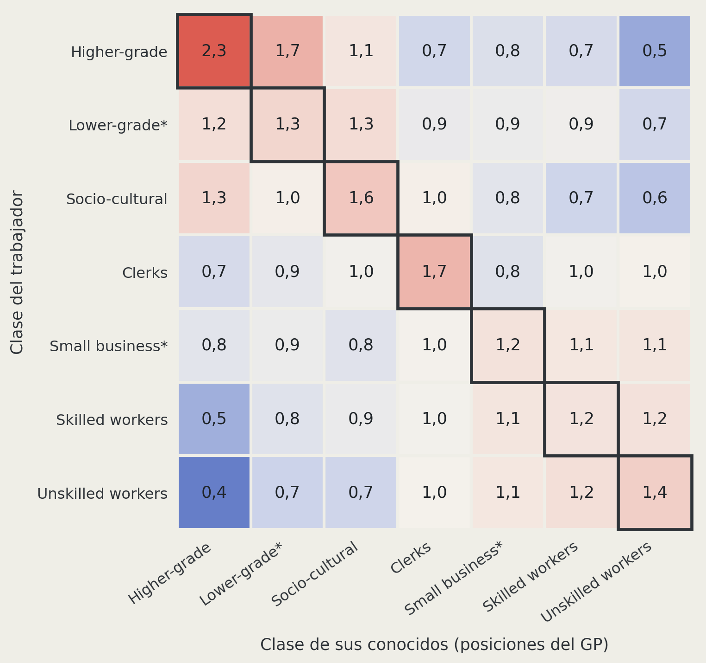

```{r}
#| include: false
# Lámina "27 ocupaciones". Lee images/gp27.csv (crosswalk v3: etiqueta, ISEI, clase)
# y, si existe, images/gp27_comunidades.csv con la porción de cada comunidad por
# posición. Formato esperado de gp27_comunidades.csv (punto decimal):
#   posicion (Q0101 a Q0127), tecnico_material, gestion_cuidado,
#   analitico_simbolico, bio_ambiental_legal (proporciones o %, se normalizan
#   por fila), y opcional n_habilidades (número de habilidades esenciales).
# Sin ese archivo, la columna de habilidades dice "pendiente".
COM_COLS <- c("tecnico_material", "gestion_cuidado", "analitico_simbolico", "bio_ambiental_legal")
COM_HEX  <- c("#7A8188", "#1A3FA8", "#7F96DB", "#E8483F")  # iguales a .c-tec, .c-ges, .c-ana, .c-bio
PUNTO    <- "\u25CF"

gp <- read.csv("images/gp27.csv", fileEncoding = "UTF-8", check.names = FALSE)
f_com <- "images/gp27_comunidades.csv"
hay_com <- FALSE
if (file.exists(f_com)) {
  com <- read.csv(f_com, fileEncoding = "UTF-8", check.names = FALSE)
  com <- com[, intersect(c("posicion", COM_COLS, "n_habilidades"), names(com)), drop = FALSE]
  if (all(c("posicion", COM_COLS) %in% names(com))) {
    gp <- merge(gp, com, by = "posicion", all.x = TRUE, sort = FALSE)
    hay_com <- TRUE
  }
}
hay_n <- hay_com && "n_habilidades" %in% names(gp)
gp <- gp[order(-gp$isei, gp$orden), ]
rownames(gp) <- NULL

# 20 puntos por posición: cada punto = 5% del perfil (resto mayor para sumar 20)
reparto20 <- function(p, k = 20) {
  p <- as.numeric(p)
  p[is.na(p)] <- 0
  if (sum(p) <= 0) return(rep(0, length(p)))
  x <- p / sum(p) * k
  base <- floor(x)
  faltan <- k - sum(base)
  if (faltan > 0) {
    idx <- order(x - base, decreasing = TRUE)[seq_len(faltan)]
    base[idx] <- base[idx] + 1
  }
  base
}

if (hay_com) {
  conteos <- t(apply(as.matrix(gp[, COM_COLS]), 1, reparto20))
  gp$franja <- apply(conteos, 1, function(n) {
    paste0(vapply(seq_along(n), function(j) {
      if (n[j] > 0) sprintf('<span style="color:%s;">%s</span>', COM_HEX[j], strrep(PUNTO, n[j])) else ""
    }, character(1)), collapse = "")
  })
} else {
  gp$franja <- '<span class="gris">pendiente</span>'
}

tabla_gp <- function(filas) {
  d <- gp[filas, ]
  enc <- c("Ocupación", "ISEI", "Clase", "Habilidades")
  ali <- c(":------------", "--:", ":-------", ":-----------")  # anchos relativos 36/8/22/33
  if (hay_n) { enc <- c(enc, "N"); ali <- c(ali, "--:") }
  lin <- c("", paste0("| ", paste(enc, collapse = " | "), " |"),
           paste0("|", paste(ali, collapse = "|"), "|"))
  for (i in seq_len(nrow(d))) {
    cl <- d$clase[i]
    if (endsWith(cl, "*")) cl <- paste0(substr(cl, 1, nchar(cl) - 1), "\\*")
    cel <- c(d$etiqueta[i], d$isei[i], cl,
             sprintf('<span class="franja">%s</span>', d$franja[i]))
    if (hay_n) cel <- c(cel, d$n_habilidades[i])
    lin <- c(lin, paste0("| ", paste(cel, collapse = " | "), " |"))
  }
  cat(lin, "", sep = "\n")
}
```

## Cierre social en redes personales: clase, estatus y habilidades en la Región Metropolitana {.title-redes}

::: {.title-rule}
:::

::: {.autor}
Trajan Pirkovic Palma¹ ²
:::

::: {.afiliacion}
¹ Instituto de Sociología, Pontificia Universidad Católica de Chile

² Fondecyt: Class, personal networks and political attitudes
:::

::: {.equipo}
Profesora Guía: Andrea Canales Hernández

Profesor Co-Tutor: Gabriel Otero Cabrol
:::

::: {.pie-portada}
Presentación de avances de tesis · 7 de octubre de 2026
:::

::: notes
Presentación de avances ante la comisión. Unos 24 minutos: problema, teoría, diseño, datos, descriptivos y un primer resultado.
:::

## Recorrido

::: {style="font-size: 60%;"}

| | | |
|--|------------|----------------------|
| **1** | **Problema de investigación** | ¿Qué sabemos de las fronteras en las redes y qué falta saber? |
| **2** | **Problema teórico** | ¿Por qué las habilidades podrían ser una frontera, y cómo reconocerla? |
| **3** | **Propósito, pregunta, objetivos e hipótesis** | ¿Qué se estudia y qué se espera encontrar? |
| **4** | **Datos y métodos** | ¿Cómo se miden habilidades, estatus y clase en las redes? |
| **5** | **Descriptivos** | ¿Cómo varían las similitudes y la homogeneidad de clase según clase y nivel educativo? |
| **6** | **Resultados preliminares** | ¿Se asocia la similitud de habilidades con la homogeneidad de clase? |

:::

::: notes
Cada bloque responde una pregunta. El problema teórico se ordena en cuatro ideas que dialogan entre sí. Los resultados son preliminares: solo H1 está en condiciones de mostrarse.
:::

# Problema de investigación {.xlarge data-background-color="#173F8A"}

## Desigualdad que se reproduce en redes

::: {.enunciado style="font-size: 92%;"}
Chile es muy desigual en ingresos, y esa desigualdad también se observa en con quién se relaciona la gente.
:::

::: columns
::: {.column width="42%"}
::: {.ficha style="font-size: 52%;"}
::: {.etq}
Ingresos
:::
[0,47]{style="font-size: 230%; font-family: 'Playfair Display', serif; color: #173F8A;"}<br>
coeficiente de Gini del ingreso monetario de los hogares (Ministerio de Desarrollo Social y Familia, 2023)

[8,2 veces]{style="font-size: 170%; font-family: 'Playfair Display', serif; color: #173F8A;"}<br>
el ingreso del 20% de hogares de mayores ingresos frente al 20% de menores ingresos (Casen 2022)

Es el registro más bajo de la serie y aun así es alto. Con datos tributarios, Chile figura entre los países más desiguales de la OCDE y de América Latina (Flores et al., 2020), y la desigualdad persiste entre generaciones, sobre todo en la parte alta (Torche, 2014).
:::
:::
::: {.column width="58%"}
::: {style="font-size: 52%;"}
::: {.etq}
Relaciones
:::

- Las personas de clase alta tienen redes más grandes, variadas y de mayor estatus ocupacional; la homogeneidad de clase de las redes es alta arriba y abajo de la estructura de clases (Otero, Völker y Rözer, 2021)
- Las fronteras de clase en las redes persisten en el tiempo, aun con movilidad social (Otero, Plaza y Zavala-Aránguiz, 2026)
- El capital social circula por redes estratificadas que favorecen a quienes vienen de orígenes altos (Contreras et al., 2019)
- La segregación de clase en las redes se asocia con divisiones de clase en las actitudes políticas (Lindh, Andersson y Volker, 2021)

:::
:::
:::

::: {.box-inv-4 .sp-after style="font-size: 56%;"}
Si las redes reproducen la desigualdad, importa saber **qué las separa**.
:::

::: notes
La desigualdad chilena no es solo de ingresos: también es relacional. Las redes canalizan información, empleo y oportunidades; si están segmentadas por clase, ayudan a reproducir la desigualdad. Otero et al. miden el estatus de los contactos con ISEI. Lindh et al. muestran que la segregación de las redes también importa para las actitudes políticas, que es el tema del Fondecyt.
:::

## Fronteras medidas en vertical

::: {.enunciado style="font-size: 92%;"}
Las fronteras de las redes se han medido en una sola dirección: arriba y abajo.
:::

::: {style="font-size: 56%;"}
**Frontera:** patrón de relaciones con muchos lazos dentro de un grupo y pocos hacia fuera. La similitud favorece el vínculo y así dibuja fronteras en las redes (McPherson, Smith-Lovin y Cook, 2001).
:::

::: columns
::: {.column width="33%"}
::: {.ficha style="font-size: 50%;"}
**Chile**

Las redes de conocidos se ordenan por cercanía de prestigio ocupacional, más allá del tamaño de cada grupo (Espinosa-Rada, Bargsted y Ortiz Ruiz, 2026)
:::
:::
::: {.column width="33%"}
::: {.ficha style="font-size: 50%;"}
**Literatura internacional**

El capital social se organiza en dos ejes: volumen de contactos y conexión con posiciones de estatus alto o bajo (Alecu et al., 2022)
:::
:::
::: {.column width="33%"}
::: {.ficha style="font-size: 50%;"}
**Clase**

La homogeneidad de clase de las redes se mide con un índice que combina educación, ocupación e ingreso (Otero, Völker y Rözer, 2021)
:::
:::
:::

::: {style="font-size: 56%;"}
Las tres ordenan a las personas en una escala vertical: quién está más arriba o más abajo.
:::

::: {.box-inv-4 .sp-after style="font-size: 56%;"}
Una escala vertical trata como equivalentes a quienes están **a la misma altura**.
:::

::: notes
Ejemplo de frontera: si los trabajadores manuales conocen sobre todo a otros trabajadores manuales y casi no a profesionales, hay una frontera entre ambos grupos. No es una barrera formal, sino un patrón de relaciones. Espinosa-Rada et al. usan el término prestigio; en esta tesis se usa estatus (ISEI). Lo común a los tres antecedentes: todos miden distancia en una escala de arriba hacia abajo.
:::

## Mismo estatus, distinto trabajo

::: {.enunciado style="font-size: 92%;"}
Dos ocupaciones a la misma altura pueden pertenecer a mundos de trabajo distintos.
:::

::: columns
::: {.column width="50%"}
::: {.ficha style="font-size: 56%;"}
::: {.etq}
Ocupación A
:::
**Electricista** · ISEI 43 · Skilled workers

Trabaja con cosas y entorno físico: [**83%**]{.c-tec} de las categorías de habilidades de su perfil son técnico-materiales.
:::
:::
::: {.column width="50%"}
::: {.ficha style="font-size: 56%;"}
::: {.etq}
Ocupación B
:::
**Secretario** · ISEI 42 · Clerks

Trabaja con símbolos e información: [**55%**]{.c-ana} de las categorías de habilidades de su perfil son analítico-simbólicas.
:::
:::
:::

::: {style="font-size: 56%;"}
Una escala de estatus los trata como equivalentes; el esquema de Oesch ya los separa en clases distintas por su lógica de trabajo. La diferencia aparece incluso dentro de una misma clase: **gerentes** (ISEI 70) e **ingenieros** (72), ambos Higher-grade, tienen perfiles distintos ([53% gestión y cuidado]{.c-ges}; [58% analítico-simbólico]{.c-ana}).
:::

::: {.box-inv-4 .sp-after style="font-size: 56%;"}
**Falta saber** si las redes también se separan por **mundos de trabajo** entre personas de estatus parecido.
:::

::: {style="font-size: 38%; color: #5a6570;"}
Perfiles de habilidades ESCO de las posiciones del generador de posiciones; detalle en datos y métodos.
:::

::: notes
Es el caso de contraste que motiva la tesis, con datos reales del generador. Electricista y secretario están a la misma altura en estatus, pero uno trabaja con cosas y el otro con información. Oesch ya los distingue por su lógica de trabajo; la pregunta es si esa diferencia también ordena con quién se relacionan. Gerentes e ingenieros muestran que la diferencia existe aun dentro de la misma clase y casi el mismo estatus.
:::

# Problema teórico {.xlarge data-background-color="#173F8A"}

## Habilidades que definen posiciones

::: {.etq}
Idea 1 de 4
:::

::: {.enunciado style="font-size: 92%;"}
El contenido del trabajo no es solo un rasgo individual: estructura posiciones de clase.
:::

::: columns
::: {.column width="33%"}
::: {.ficha style="font-size: 50%;"}
**Wright (2005)**

Las habilidades y credenciales escasas son un activo: configuran posiciones privilegiadas dentro de las relaciones de clase.
:::
:::
::: {.column width="33%"}
::: {.ficha style="font-size: 50%;"}
**Oesch (2006)**

La clase combina nivel de calificación y lógica de trabajo: técnica, organizacional e interpersonal. El contenido del trabajo ya es criterio de clase.
:::
:::
::: {.column width="33%"}
::: {.ficha style="font-size: 50%;"}
**Alabdulkareem et al. (2018) y ESCO**

Las habilidades forman comunidades separadas en el espacio ocupacional, y se pueden medir ocupación por ocupación (Comisión Europea, s. f.).
:::
:::
:::

::: {style="font-size: 56%;"}
Oesch usa el contenido del trabajo como criterio **individual** de clase. La tesis lo lleva al plano **relacional**.
:::

::: {.box-inv-4 .sp-after style="font-size: 56%;"}
Si las habilidades definen posiciones, ¿pueden también **trazar fronteras** entre personas?
:::

::: notes
Cadena teórica: Wright pone las habilidades como activo de clase; Oesch las vuelve criterio para dibujar clases, con su eje horizontal de lógicas de trabajo; Alabdulkareem et al. muestran que el contenido del trabajo tiene estructura propia y ESCO permite medirlo. Si la clase ya incluye el contenido del trabajo, es razonable preguntar si ese contenido también ordena las redes.
:::

## Posiciones que se vuelven fronteras

::: {.etq}
Idea 2 de 4
:::

::: {.enunciado style="font-size: 92%;"}
Toda posición social puede volverse base de cierre: separar a unos de otros y, a veces, acaparar ventajas.
:::

::: {style="font-size: 54%;"}
**Cierre social:** los grupos restringen el acceso a recursos y oportunidades a un círculo de elegibles (Weber, 1978; Parkin, 1979). Las desigualdades persistentes surgen de relaciones que acaparan oportunidades (Tilly, 1998; Tomaskovic-Devey y Avent-Holt, 2019).
:::

::: columns
::: {.column width="33%"}
::: {.ficha style="font-size: 50%;"}
**Nivel educativo**

Las credenciales son el canal formal de cierre: definen quién puede acceder a ciertas ocupaciones (Parkin, 1979; Weeden, 2002).
:::
:::
::: {.column width="33%"}
::: {.ficha style="font-size: 50%;"}
**Similitud de estatus**

Cercanía en la jerarquía ocupacional, medida con el estatus socioeconómico ocupacional (ISEI; Ganzeboom et al., 1992). Es la dimensión más estudiada en redes.
:::
:::
::: {.column width="33%"}
::: {.ficha style="font-size: 50%;"}
**Similitud de habilidades**

Cercanía en el contenido del trabajo. Las ocupaciones son el lugar donde opera el cierre (Weeden y Grusky, 2005). Es la dimensión que propone la tesis.
:::
:::
:::

::: {.box-inv-4 .sp-after style="font-size: 56%;"}
Tres dimensiones **al mismo nivel**: ninguna es la que hay que superar. ¿Dónde se vuelve observable el cierre?
:::

::: notes
El cierre social es el marco general: grupos que trazan fronteras para restringir el acceso de otros. En el trabajo, la vía clásica son las credenciales; la más estudiada en redes es el estatus; la tesis agrega las habilidades. Las tres son dimensiones del cierre al mismo nivel, y por eso las tres aparecen en la pregunta.
:::

## Fronteras visibles en redes

::: {.etq}
Idea 3 de 4
:::

::: {.enunciado style="font-size: 92%;"}
Las redes son donde el cierre se vuelve observable, pero también pueden ser lo contrario: puentes.
:::

::: {style="font-size: 54%;"}
Las redes canalizan información, recomendaciones y oportunidades (Lin, 2001), y pueden ampliar o reducir la desigualdad según cómo se distribuyen los contactos (DiMaggio y Garip, 2012). Una frontera por habilidades debería verse en redes parecidas en habilidades. Esa similitud admite tres lecturas:
:::

::: {style="font-size: 52%;"}

| Lectura | Qué predice | Antecedentes |
|-----|----------------|----------|
| **Cierre** | La red parecida protege oportunidades: **más ingreso** | Weber (1978); Parkin (1979); Weeden (2002) |
| **Apertura** | La red parecida es redundante; la información nueva llega por contactos distintos: **menos ingreso** | Granovetter (1973); Burt (1992); Lin (2001) |
| **Segmentación** | La red separa mundos de trabajo: **sin diferencia de ingreso** | Expectativa nula |

:::

::: {.box-inv-4 .sp-after style="font-size: 56%;"}
**Separar o acaparar:** lo examina OE3. Pero antes, ¿una red parecida es siempre frontera?
:::

::: notes
Cierre: entre electricistas se pasan trabajos y se recomiendan. Apertura: si todos saben de los mismos trabajos, la información nueva llega por los contactos distintos. Segmentación: la red parecida no pesa en lo que cada uno obtiene. El ingreso es el terreno donde estas lecturas se separan.
:::

## Redes que reflejan estructura

::: {.etq}
Idea 4 de 4
:::

::: {.enunciado style="font-size: 92%;"}
Parte de con quién se relaciona la gente depende solo de con quién es posible encontrarse.
:::

::: {style="font-size: 54%;"}
**Estructura.** Las oportunidades de encuentro dependen del tamaño y la distribución de los grupos (Blau, 1977) y de los espacios que se comparten: trabajo, barrio, familia (Feld, 1981). La homofilia observada combina esa estructura (homofilia de base) y lo que la excede (homofilia de exceso) (McPherson et al., 2001; Kossinets y Watts, 2009).

**Un ejemplo.** Pedro, electricista, va a una fiesta donde la mitad son mecánicos: los conoce sin buscarlos. Eso es estructura. Si conoce más mecánicos de los que la fiesta le ofrece, hay algo más.

**En esta tesis.** Las clases agrupan ocupaciones con contenido de trabajo parecido. Quien conoce más gente de su clase tiene, por eso mismo, una red más parecida en habilidades: homogeneidad de clase y similitud de habilidades se mueven juntas por construcción.
:::

::: {.box-inv-4 .sp-after style="font-size: 56%;"}
**Frontera o estructura:** lo examina OE2. Sin descontar la estructura, se confunde composición con cierre.
:::

::: notes
Lo que se distingue es cuánto de la similitud entre el trabajador y sus conocidos viene de lo disponible y cuánto lo excede. El exceso no equivale a elección: puede venir de preferencias o de contextos compartidos. Esta idea corrige a las otras tres: antes de leer una red parecida como frontera, hay que descontar la estructura.
:::

## Cuatro ideas en diálogo

::: {style="font-size: 50%; margin-bottom: 0.6em;"}
**1** Habilidades que definen posiciones &nbsp;·&nbsp; **2** Posiciones que se vuelven fronteras &nbsp;·&nbsp; **3** Fronteras visibles en redes &nbsp;·&nbsp; **4** Redes que reflejan estructura
:::

::: columns
::: {.column width="33%"}
::: {.ficha style="font-size: 52%;"}
::: {.etq}
1 y 2 · la pregunta
:::
Si las habilidades definen posiciones y toda posición puede volverse frontera, ¿son las habilidades una dimensión del cierre, junto al estatus y las credenciales?
:::
:::
::: {.column width="33%"}
::: {.ficha style="font-size: 52%;"}
::: {.etq}
3 · la prueba y una tensión
:::
El cierre debería verse en redes parecidas en habilidades. Pero cierre y apertura predicen lo contrario para el ingreso.
:::
:::
::: {.column width="33%"}
::: {.ficha style="font-size: 52%;"}
::: {.etq}
4 · la corrección
:::
Antes de leer una red parecida como frontera, hay que descontar lo que produce la estructura de oportunidades de encuentro.
:::
:::
:::

::: {style="font-size: 58%;"}
**Síntesis.** Una frontera puede separar mundos sin concentrar ventajas (**segmentación horizontal**) o separar y concentrar ventajas (**cierre vertical**).
:::

::: {.box-inv-4 .sp-after style="font-size: 58%;"}
¿Dónde se ubican las habilidades, frente al estatus y la educación?
:::

::: notes
Así dialogan: 1 y 2 abren la pregunta; 3 pone la prueba y una tensión sobre el ingreso; 4 corrige, porque no toda red parecida es frontera. Del cruce sale la distinción que ordena la tesis: segmentación horizontal frente a cierre vertical.
:::

## Problema en síntesis {.frase}

Si las habilidades definen posiciones, pueden volverse [fronteras]{.azul} visibles en las redes, siempre que se distinga la frontera de la [estructura]{.rojo}. La tesis pregunta [qué tipo de frontera]{.azul} son.

::: notes
Esta frase resume las cuatro ideas. Lo que sigue (propósito, pregunta, objetivos e hipótesis) la traduce en un diseño.
:::

# Propósito, pregunta, objetivos e hipótesis {.xlarge data-background-color="#173F8A"}

## Propósito

::: {.enunciado}
Examinar si la similitud de habilidades laborales es una dimensión del cierre social en las redes personales, distinta del estatus ocupacional y de las credenciales educativas.
:::

::: {style="font-size: 62%;"}

**Aportes**

- Incorporar una medida de habilidades laborales (ESCO) al estudio de redes y clase
- Distinguir la similitud que produce la disponibilidad de ocupaciones de la que la excede
- Distinguir tipos de frontera: horizontal y vertical

:::

::: notes
Las tres dimensiones del cierre están al mismo nivel: similitud de habilidades, similitud de estatus y nivel educativo. Ninguna es la que hay que superar. La educación entra porque las credenciales son el canal clásico de cierre (Parkin; Weeden).
:::

## Pregunta de investigación {.frase}

¿Cómo interactúan el [nivel educativo]{.azul} de los trabajadores y su [similitud de habilidades laborales y de estatus]{.azul} con sus conocidos al asociarse con la [homogeneidad de clase]{.rojo} de sus redes y con su [ingreso laboral]{.rojo}, en la Región Metropolitana en 2025?

::: notes
El nivel educativo es del trabajador; las similitudes se miden entre el trabajador y sus conocidos (posiciones del generador); los resultados son la homogeneidad de clase de sus redes y su ingreso laboral.
:::

## Objetivos

::: {.ficha style="font-size: 56%;"}
**Objetivo general.** Analizar cómo interactúan el nivel educativo de los trabajadores y su similitud de habilidades laborales y de estatus con sus conocidos al asociarse con la homogeneidad de clase de sus redes y con su ingreso laboral, en la Región Metropolitana en 2025.
:::

::: {style="font-size: 56%;"}

| | Objetivo específico |
|--|--------------------|
| **OE1** | **Describir** la similitud de habilidades laborales y de estatus entre los trabajadores de la Región Metropolitana y sus conocidos en 2025 |
| **OE2** | **Estimar** la asociación de la similitud de habilidades laborales y de estatus con la homogeneidad de clase de las redes de los trabajadores de la Región Metropolitana en 2025, según su nivel educativo |
| **OE3** | **Examinar** la asociación entre la similitud de habilidades laborales con sus conocidos y el ingreso laboral de los trabajadores ocupados de la Región Metropolitana en 2025, a igual nivel educativo, estatus ocupacional y clase, y su variación según la similitud de estatus y el estatus ocupacional |

:::

::: notes
OE1 es descriptivo y no lleva hipótesis. OE2 responde la tensión frontera o estructura; OE3, la tensión separar o acaparar.
:::

## Hipótesis: homogeneidad de clase

::: {.etq}
OE2 · trabajadores de la Región Metropolitana
:::

::: {style="font-size: 52%;"}

| | Enunciado | Fundamento |
|----|----------------|------------|
| **H1** | A mayor similitud de habilidades laborales con sus conocidos, mayor homogeneidad de clase de sus redes, a igual similitud de estatus | Las habilidades como base de clase y las ocupaciones como lugar de cierre (Wright, 2005; Oesch, 2006; Weeden y Grusky, 2005) |
| *Descomposición de H1* | Qué parte de la asociación de la similitud de habilidades y de estatus con la homogeneidad de clase excede la que produce la disponibilidad de ocupaciones *(análisis, no hipótesis)* | Homofilia de base y de exceso (McPherson et al., 2001; Feld, 1981; Kossinets y Watts, 2009) |
| **H2** | La asociación entre la similitud de habilidades laborales y la homogeneidad de clase es mayor en quienes tienen menor nivel educativo | Las credenciales como canal formal de cierre; sin ellas, el oficio compartido sería la base principal de la frontera (Parkin, 1979; Weeden, 2002) |

:::

::: notes
H1 y H2 son correlacionales; H2 es una interacción. La descomposición no agrega una relación nueva: permite leer H1 como cierre y no como composición. Está en desarrollo.
:::

## Hipótesis: ingreso laboral

::: {.etq}
OE3 · trabajadores ocupados de la Región Metropolitana
:::

::: {style="font-size: 52%;"}

| | Enunciado | Fundamento |
|----|----------------|------------|
| **H3** | A mayor similitud de habilidades laborales con sus conocidos, mayor ingreso laboral, a igual nivel educativo, estatus ocupacional y clase | Cierre: las fronteras protegen oportunidades (Weber, 1978; Parkin, 1979; Weeden, 2002). *Rival, apertura:* la red parecida es redundante (Granovetter, 1973; Burt, 1992; Lin, 2001) |
| **H3a** | La asociación entre la similitud de habilidades laborales y el ingreso laboral es mayor cuanto mayor es la similitud de estatus con sus conocidos | Las fronteras se refuerzan cuando las dimensiones de diferenciación coinciden (Blau, 1977) |
| **H3b** | La asociación entre la similitud de habilidades laborales y el ingreso laboral es mayor en quienes tienen estatus ocupacional alto que en quienes tienen estatus medio o bajo | La homogeneidad de las redes expresa preservación de recursos arriba y exclusión abajo (Otero, Völker y Rözer, 2021) |

:::

::: notes
H3 es correlacional; H3a y H3b son interacciones. H3a mira con quién se relaciona el trabajador en estatus; H3b, dónde está él en la jerarquía. Se estiman por separado. Los tramos de estatus de H3b se fijan antes de estimar.
:::

# Datos y métodos {.xlarge data-background-color="#173F8A"}

## Datos: encuesta Fondecyt y generador de posiciones

::: {.enunciado}
"¿Puede indicarme, aunque sea en términos aproximados, cuántas personas que usted conoce son…?"
:::

::: {style="font-size: 56%;"}
Se pregunta por 27 ocupaciones. Los conocidos pueden ser familiares, amigos u otras personas con las que se podría conversar al encontrarlas en la calle o en un centro comercial.
:::

::: columns
::: {.column width="50%"}
::: {.ficha style="font-size: 54%;"}
**Datos**

Encuesta Fondecyt *Class, Personal Networks and Political Attitudes*, Región Metropolitana, 2025. Generador de posiciones (Lin y Dumin, 1986). Clase: esquema de Oesch (2006) en siete clases. Estimaciones con ponderador muestral.
:::
:::
::: {.column width="50%"}
::: {.ficha style="font-size: 54%;"}
**Muestras**

**971 trabajadores** y 30.207 menciones en los modelos de homogeneidad de clase; incluye 189 no ocupados, con la clase de su última ocupación. **767 ocupados** con ingreso laboral en el modelo de ingreso.
:::
:::
:::

::: notes
El generador de posiciones no pregunta por nombres, sino cuántas personas conoce en cada ocupación. La muestra paso a paso está en respaldo. Los no ocupados entran en los modelos de redes porque su red sigue existiendo; en el de ingreso solo quedan quienes tienen ingreso del trabajo.
:::

## De ocupaciones a habilidades

::: columns
::: {.column width="25%"}
::: {.ficha style="font-size: 50%;"}
**Ocupación**

Código ISCO-08 de cada posición del GP y de cada trabajador (OIT, 2012)
:::
:::
::: {.column width="25%"}
::: {.ficha style="font-size: 50%;"}
**Perfil de habilidades**

Habilidades esenciales que ESCO asigna a esa ocupación (Comisión Europea, s. f.)
:::
:::
::: {.column width="25%"}
::: {.ficha style="font-size: 50%;"}
**Red de 112 categorías**

Unidas si aparecen juntas en las ocupaciones más que por azar (φ; Alabdulkareem et al., 2018)
:::
:::
::: {.column width="25%"}
::: {.ficha style="font-size: 50%;"}
**Cuatro comunidades**

Detectadas con el algoritmo de Leiden (Traag et al., 2019); modularidad 0,388
:::
:::
:::

::: {style="font-size: 56%;"}

| Comunidad | Objeto del trabajo | Ejemplos del GP |
|------|-------|-------------|
| [**Técnico-material**]{.c-tec} | Cosas y entorno físico | Obreros 89%, electricistas 83% |
| [**Gestión y cuidado**]{.c-ges} | Personas: coordinar y atender | Profesores de básica y media 77%, abogados 64% |
| [**Analítico-simbólico**]{.c-ana} | Símbolos e información | Ingenieros 58%, secretarios 55% |
| [**Bio-ambiental-legal**]{.c-bio} | Seres vivos, ambiente y derecho | No predomina en ninguna posición; aparece de ISEI 16 a 85 |

:::

::: {.box-inv-4 .sp-after style="font-size: 56%;"}
Cada ocupación es una **mezcla**: su perfil de habilidades se reparte entre las cuatro comunidades.
:::

::: notes
Las comunidades no se definieron a mano: salen de cómo las habilidades aparecen juntas en las ocupaciones. Por eso la bio-ambiental-legal reúne derecho, agricultura y ambiente: comparten conocimiento regulatorio y sanitario. Los porcentajes son la porción de las categorías de habilidades del perfil de cada ocupación que cae en esa comunidad.
:::

## 27 ocupaciones: estatus, clase y habilidades

::: {style="font-size: 50%; text-align: center; margin-bottom: 0.4em;"}
[●]{.c-tec} Técnico-material &nbsp;&nbsp; [●]{.c-ges} Gestión y cuidado &nbsp;&nbsp; [●]{.c-ana} Analítico-simbólico &nbsp;&nbsp; [●]{.c-bio} Bio-ambiental-legal &nbsp;&nbsp;·&nbsp;&nbsp; cada punto = 5% de las categorías de habilidades del perfil
:::

::: columns
::: {.column width="50%"}
::: {.tabla-gp style="font-size: 40%;"}
```{r}
#| results: asis
tabla_gp(1:14)
```
:::
:::
::: {.column width="50%"}
::: {.tabla-gp style="font-size: 40%;"}
```{r}
#| results: asis
tabla_gp(15:27)
```
:::
:::
:::

::: {style="font-size: 38%; color: #5a6570;"}
Ordenadas por ISEI-08. Clase Oesch7. \* Clase con una sola posición en el GP. Enfermeros o TENS: perfil del código 5321, porque 3221 no tiene ocupaciones en ESCO. Cinco códigos agregados usan el grupo unitario más frecuente en Casen RM.
:::

::: {.box-inv-4 .sp-after style="font-size: 52%;"}
**Estatus parecido, contenido distinto:** electricistas (43) y secretarios (42); gerentes (70) e ingenieros (72).
:::

::: notes
Esta lámina resume todo el material con que se trabaja: cada ocupación del generador tiene un estatus (ISEI), una clase (Oesch) y un perfil de habilidades repartido en cuatro comunidades. La clase y el estatus van juntos en buena medida; las habilidades cruzan la escala de estatus. Si preguntan: los porcentajes son de categorías de habilidades del perfil ESCO, y algunos perfiles son delgados (repartidores, 2 categorías; médicos, 3; trabajadores agrícolas, 6; carabineros, 7). Por eso los ejemplos usan perfiles con más categorías.
:::

## Tres medidas, cuatro personas

::: {style="font-size: 50%;"}

| Persona | Conoce a | [Similitud de habilidades]{.azul} | [Similitud de estatus]{.rojo} | Homogeneidad de clase |
|-----------|---------|-----|-----|-----|
| **Pedro**, electricista (Skilled workers, ISEI 43) | Mecánicos, camioneros, cocineros | ●●● alta | ●●● alta | 100% |
| **Rosa**, obrera de construcción (Unskilled workers, ISEI 24) | Electricistas, mecánicos | ●●● alta | ●●○ media | 0% |
| **Carla**, abogada (Higher-grade, ISEI 85) | Médicos, profesores universitarios | ●○○ baja | ●●● alta | 0% |
| **Sofía**, ingeniera (Higher-grade, ISEI 72) | Gerentes, altos funcionarios | ●○○ baja | ●●● alta | 100% |

:::

::: {style="font-size: 52%;"}

- [**Similitud de habilidades:**]{.azul} cuán cerca están las ocupaciones de los conocidos de la del trabajador en la red de habilidades ESCO
- [**Similitud de estatus:**]{.rojo} cuán cerca están en la escala ISEI
- **Homogeneidad de clase:** porcentaje de conocidos en la propia clase

:::

::: {style="font-size: 40%; color: #5a6570;"}
Niveles ilustrativos, según la comunidad predominante y el ISEI de cada ocupación (lámina anterior). Clases e ISEI reales del GP.
:::

::: {.box-inv-4 .sp-after style="font-size: 56%;"}
Las tres medidas pueden ir juntas (Pedro) o separarse (Rosa, Carla, Sofía).
:::

::: notes
Pedro: todo junto. Rosa: habilidades parecidas sin homogeneidad de clase, porque electricistas y mecánicos son Skilled y ella Unskilled. Carla: estatus parecido sin habilidades ni clase, porque médicos y profesores universitarios son Socio-cultural. Sofía: clase y estatus sin habilidades.
:::

## Estrategia de análisis

::: {style="font-size: 48%;"}

| | Herramienta | Variable dependiente | Variable principal | N | Estado |
|----|----------|---------|---------|--:|-----|
| **OE1** | Descriptivos ponderados; Modelos A y B (respaldo) | Similitudes y composición de habilidades de la red | Clase y nivel educativo | 971 | Estimado |
| **H1** | Modelos C1 y C2: logit fraccional | Homogeneidad de clase (proporción) | Similitud de habilidades; en C2 se agrega similitud de estatus | 971 | Estimado |
| *Descomposición de H1* | Análisis complementario | Coeficientes de C1 y C2 | | 971 | En desarrollo |
| **H2** | C2 + similitud de habilidades × nivel educativo | Homogeneidad de clase (proporción) | Similitud de habilidades | 971 | Pendiente |
| **H3** | Modelo D: regresión lineal por bloques | Logaritmo del ingreso laboral | Similitud de habilidades | 767 | Estimado |
| **H3a** | Modelo Da: D + similitud de habilidades × similitud de estatus | Logaritmo del ingreso laboral | Similitud de habilidades | 767 | Pendiente |
| **H3b** | Modelo Db: D + similitud de habilidades × estatus en tramos | Logaritmo del ingreso laboral | Similitud de habilidades | 767 | Pendiente |

:::

::: {.box-inv-4 .sp-after style="font-size: 54%;"}
Todos con ponderador muestral (`svyglm`). Controles en los modelos de red: sexo, edad, nivel educativo (cinco niveles), ingreso y número de conocidos; en H1 y H2, además, clase del trabajador.<br>
Diseño muestral provisional: pesos sin estratos ni conglomerados.
:::

::: notes
Los modelos llevan letras para no confundirlos con las hipótesis. Las interacciones (H2, H3a y H3b) están pendientes de acordar con el equipo. El logit fraccional se usa porque la homogeneidad es una proporción entre 0 y 1.
:::

# Descriptivos {.xlarge data-background-color="#173F8A"}

## Tres medidas por clase

::: {style="font-size: 52%;"}

| Clase | Trabajadores | Posiciones en el GP | Conocidos (media) | Similitud de habilidades (DE) | Distancia de estatus (puntos ISEI) | Homogeneidad de clase (%) |
|:---|---:|---:|---:|---:|---:|---:|
| Higher-grade | 96 | 5 | 40,7 | 0,13 | 19,9 | 30,3 |
| Lower-grade\* | 80 | 1 | 37,0 | −0,32 | 17,4 | 3,9 |
| Socio-cultural | 111 | 6 | 44,4 | 0,63 | 19,1 | 39,2 |
| Clerks | 94 | 3 | 29,8 | −0,19 | 14,0 | 17,5 |
| Small business\* | 138 | 1 | 38,7 | −0,33 | 15,8 | 6,8 |
| Skilled workers | 192 | 6 | 28,0 | 0,05 | 14,1 | 29,9 |
| Unskilled workers | 260 | 5 | 25,7 | 0,02 | 15,5 | 38,4 |
| **Total** | **971** | **27** | **33,0** | **0,00** | **16,1** | **26,5** |

Medias ponderadas. Similitud de habilidades: 0 = promedio de la muestra. Distancia de estatus: más distancia, menos similitud de estatus. \* Una sola posición en el GP (contadores; comerciantes).

:::

::: {.box-inv-4 .sp-after style="font-size: 54%;"}
**Similitudes distintas:** correlación de 0,23 entre ambas, y de 0,08 entre similitud de habilidades e ISEI del trabajador.<br>
Socio-cultural tiene las redes más parecidas en habilidades; Higher-grade y Socio-cultural, las más lejanas en estatus.
:::

::: notes
Cómo leer: Socio-cultural conoce gente 0,63 DE más parecida a ella en habilidades que el promedio. En estatus, Higher-grade y Socio-cultural quedan a 19 o 20 puntos ISEI de sus conocidos, en parte porque el GP tiene pocas posiciones de estatus alto. En las dos clases con una sola posición, homogeneidad significa conocer contadores o comerciantes: no se interpretan por clase.
:::

## Tres medidas por nivel educativo

::: {style="font-size: 58%;"}

| Nivel educativo | Trabajadores | Similitud de habilidades (DE) | Distancia de estatus (puntos ISEI) | Homogeneidad de clase (%) |
|:---|---:|---:|---:|---:|
| Básica o menos | 79 | 0,11 | 15,2 | 35,0 |
| Media incompleta | 90 | −0,05 | 14,1 | 28,7 |
| Media completa | 371 | −0,19 | 14,3 | 26,6 |
| Técnica superior | 165 | 0,03 | 16,8 | 19,8 |
| Universitaria | 266 | 0,23 | 19,2 | 26,6 |

Medias ponderadas, sin controles.

:::

::: {.box-inv-4 .sp-after style="font-size: 54%;"}
**Homogeneidad de clase** baja de 35% (básica o menos) a 20% (técnica superior) y sube a 27% en universitaria. **Distancia de estatus** mayor con educación superior. **Similitud de habilidades** en forma de U.<br>
Antesala de H2: ¿la asociación entre similitud de habilidades y homogeneidad de clase varía según nivel educativo?
:::

::: notes
Son promedios simples por nivel educativo, no un modelo. Muestran que el nivel educativo se relaciona con las tres medidas, y por eso H2 pregunta si la asociación central cambia según educación. La distancia de estatus de los universitarios no se explica por la oferta del GP (Modelo B, respaldo).
:::

# Resultados preliminares {.xlarge data-background-color="#173F8A"}

## H1: similitud de habilidades y homogeneidad de clase

::: {.enunciado}
**H1.** A mayor similitud de habilidades laborales con sus conocidos, mayor homogeneidad de clase de sus redes, a igual similitud de estatus.
:::

::: {style="font-size: 56%;"}
$$\operatorname{logit} E(\text{Homogeneidad}_i) = \beta_0 + \beta_1\, SH_i\;(+\ \beta_2\, SP_i) + \text{clase}_i + \gamma' X_i$$
:::

::: columns
::: {.column width="50%"}
::: {style="font-size: 50%;"}

| | C1 | C2 |
|---|---|---|
| **Similitud de habilidades (1 DE)** | **0,378\*\*\*** (0,044) | **0,279\*\*\*** (0,042) |
| **Similitud de estatus (1 DE)** | | **0,433\*\*\*** (0,047) |
| Clase y controles | sí | sí |
| Pseudo-R² | 0,489 | 0,563 |

Logit fraccional ponderado, N = 971. Error estándar entre paréntesis. Solo clase y controles: pseudo-R² 0,41.

:::
:::
::: {.column width="50%"}
::: {style="font-size: 54%;"}

**En puntos porcentuales de homogeneidad (por 1 DE)**

| | C1 | C2 |
|---|---|---|
| Similitud de habilidades | +6,5 pp | +4,7 pp |
| Similitud de estatus | | +7,3 pp |

**Atenuación** al agregar similitud de estatus: 0,378 → 0,279 (26%). Mismo patrón en cuatro chequeos de robustez (respaldo).

:::
:::
:::

::: {.box-inv-4 .sp-after style="font-size: 54%;"}
Dos electricistas con igual clase, educación, ingreso y 16 conocidos: si la red de uno es 1 DE más parecida a él en habilidades, se espera **6,5 pp** más de homogeneidad de clase, cerca de un conocido más de su clase; **4,7 pp** a igual similitud de estatus.<br>
Resultado preliminar consistente con H1. Falta distinguir qué parte viene de la estructura de ocupaciones.
:::

::: notes
C1 tiene solo similitud de habilidades; C2 agrega similitud de estatus, que es lo que pide H1. La asociación baja un 26% pero se mantiene: parte se superpone con el estatus. Los coeficientes de clase no se interpretan, porque dependen de cuántas posiciones tiene cada clase en el GP. La idea 4 (redes que reflejan estructura) explica por qué este resultado todavía no basta: eso es la descomposición, en desarrollo.
:::

## Síntesis y próximos pasos

::: columns
::: {.column width="50%"}
::: {.ficha style="font-size: 54%;"}
**Hasta ahora**

- Similitud de habilidades y de estatus son medidas distintas y varían de forma distinta por clase y nivel educativo (OE1)
- A igual similitud de estatus, redes más parecidas en habilidades tienen mayor homogeneidad de clase (H1, preliminar)
- A igual nivel educativo, estatus ocupacional y clase, la similitud de habilidades no se asocia con el ingreso laboral (H3, preliminar)
:::
:::
::: {.column width="50%"}
::: {.ficha style="font-size: 54%;"}
**Próximos pasos**

- Descomposición de H1: estructura de ocupaciones y relación
- H2: variación según nivel educativo
- H3a y H3b: variación según similitud de estatus y estatus ocupacional
- Diseño muestral completo (estratos y conglomerados)
- Escritura de resultados y discusión
:::
:::
:::

::: {.box-inv-4 .sp-after style="font-size: 58%;"}
Las habilidades se asocian con la homogeneidad de clase de las redes, más allá del estatus.<br>
Pendiente: cuánto de esa asociación excede la estructura de ocupaciones y si se traduce en ventajas.
:::

::: notes
H3 se menciona solo en una línea: la asociación bruta con el ingreso desaparece al comparar a igual nivel educativo. El detalle está en respaldo.
:::

## Referencias (1 de 2)

::: {style="font-size: 38%; column-count: 2; column-gap: 2em; text-align: left;"}

Alabdulkareem, A., Frank, M. R., Sun, L., AlShebli, B., Hidalgo, C., & Rahwan, I. (2018). Unpacking the polarization of workplace skills. *Science Advances, 4*(7), eaao6030. https://doi.org/10.1126/sciadv.aao6030

Alecu, A. I., Helland, H., Hjellbrekke, J., & Jarness, V. (2022). Who you know: The classed structure of social capital. *The British Journal of Sociology, 73*(3), 505–535. https://doi.org/10.1111/1468-4446.12945

Blau, P. M. (1977). *Inequality and heterogeneity: A primitive theory of social structure*. Free Press.

Burt, R. S. (1992). *Structural holes: The social structure of competition*. Harvard University Press.

Comisión Europea. (s. f.). *ESCO: European Skills, Competences, Qualifications and Occupations*. https://esco.ec.europa.eu

Contreras, D., Otero, G., Díaz, J. D., & Suárez, N. (2019). Inequality in social capital in Chile: Assessing the importance of network size and contacts' occupational prestige on status attainment. *Social Networks, 58*, 59–77. https://doi.org/10.1016/j.socnet.2019.02.002

DiMaggio, P., & Garip, F. (2012). Network effects and social inequality. *Annual Review of Sociology, 38*, 93–118. https://doi.org/10.1146/annurev.soc.012809.102545

Espinosa-Rada, A., Bargsted, M., & Ortiz Ruiz, F. (2026). Socioeconomic homogeneity in acquaintance networks: Occupational prestige, education, and intergenerational mobility. *Social Networks, 86*, 342–353.

Feld, S. L. (1981). The focused organization of social ties. *American Journal of Sociology, 86*(5), 1015–1035.

Flores, I., Sanhueza, C., Atria, J., & Mayer, R. (2020). Top incomes in Chile: A historical perspective on income inequality, 1964–2017. *Review of Income and Wealth, 66*(4), 850–874. https://doi.org/10.1111/roiw.12441

Ganzeboom, H. B. G. (2010). *A new International Socio-Economic Index (ISEI) of occupational status for the International Standard Classification of Occupation 2008 (ISCO-08) constructed with data from the ISSP 2002–2007* [Ponencia]. Annual Conference of the International Social Survey Programme, Lisboa.

Ganzeboom, H. B. G., De Graaf, P. M., & Treiman, D. J. (1992). A standard international socio-economic index of occupational status. *Social Science Research, 21*(1), 1–56.

Granovetter, M. S. (1973). The strength of weak ties. *American Journal of Sociology, 78*(6), 1360–1380.

Kossinets, G., & Watts, D. J. (2009). Origins of homophily in an evolving social network. *American Journal of Sociology, 115*(2), 405–450. https://doi.org/10.1086/599247

Lin, N. (2001). *Social capital: A theory of social structure and action*. Cambridge University Press.

Lin, N., & Dumin, M. (1986). Access to occupations through social ties. *Social Networks, 8*(4), 365–385.

:::

## Referencias (2 de 2)

::: {style="font-size: 38%; column-count: 2; column-gap: 2em; text-align: left;"}

Lindh, A., Andersson, A. B., & Volker, B. (2021). The missing link: Network influences on class divides in political attitudes. *European Sociological Review, 37*(5), 695–712. https://doi.org/10.1093/esr/jcab010

McPherson, M., Smith-Lovin, L., & Cook, J. M. (2001). Birds of a feather: Homophily in social networks. *Annual Review of Sociology, 27*, 415–444.

Ministerio de Desarrollo Social y Familia. (2023). *Encuesta de Caracterización Socioeconómica Nacional (Casen) 2022: Ingresos de los hogares. Síntesis de resultados*. Observatorio Social.

Oesch, D. (2006). *Redrawing the class map: Stratification and institutions in Britain, Germany, Sweden and Switzerland*. Palgrave Macmillan.

Organización Internacional del Trabajo. (2012). *Clasificación Internacional Uniforme de Ocupaciones: CIUO-08*. OIT.

Otero, G., Plaza, A., & Zavala-Aránguiz, I. (2026). Social mobility and class segregation in personal networks over time: Evidence from longitudinal data. *Frontiers in Sociology, 11*. https://doi.org/10.3389/fsoc.2026.1782127

Otero, G., Völker, B., & Rözer, J. (2021). Open but segregated? Class divisions and the network structure of social capital in Chile. *Social Forces, 100*(2), 649–679.

Parkin, F. (1979). *Marxism and class theory: A bourgeois critique*. Tavistock.

Tilly, C. (1998). *Durable inequality*. University of California Press.

Tomaskovic-Devey, D., & Avent-Holt, D. (2019). *Relational inequalities: An organizational approach*. Oxford University Press.

Torche, F. (2014). Intergenerational mobility and inequality: The Latin American case. *Annual Review of Sociology, 40*, 619–642. https://doi.org/10.1146/annurev-soc-071811-145521

Traag, V. A., Waltman, L., & van Eck, N. J. (2019). From Louvain to Leiden: Guaranteeing well-connected communities. *Scientific Reports, 9*, 5233.

Weber, M. (1978). *Economy and society*. University of California Press.

Weeden, K. A. (2002). Why do some occupations pay more than others? Social closure and earnings inequality in the United States. *American Journal of Sociology, 108*(1), 55–101. https://doi.org/10.1086/344121

Weeden, K. A., & Grusky, D. B. (2005). The case for a new class map. *American Journal of Sociology, 111*(1), 141–212. https://doi.org/10.1086/428815

Wright, E. O. (2005). Foundations of a neo-Marxist class analysis. En E. O. Wright (Ed.), *Approaches to class analysis* (pp. 4–30). Cambridge University Press.

:::

# Respaldo {.xlarge data-background-color="#173F8A"}

## Tres medidas de red

::: {style="font-size: 60%;"}
$$SH_i = \frac{\sum_p n_{ip}\, SH_{ip}}{\sum_p n_{ip}} \qquad SP_i = \frac{\sum_p n_{ip}\, SP_{ip}}{\sum_p n_{ip}} \qquad \text{Homogeneidad}_i = \frac{\sum_p n_{ip}\, \mathbb{1}[\text{clase}_i = \text{clase}_p]}{\sum_p n_{ip}}$$
:::

::: {style="font-size: 54%;"}

| Medida | Construcción | Lectura |
|------|---------------|---------|
| [**Similitud de habilidades**]{.azul} | Promedio de $SH_{ip}$, ponderado por conocidos $n_{ip}$. $SH_{ip}$ es la distancia entre la ocupación del trabajador y la de la posición en la red de categorías de habilidades (pesos 1 − φ), con signo negativo | Más alto: los conocidos se parecen más al trabajador en lo que sabe hacer |
| [**Similitud de estatus**]{.rojo} | Promedio de $-\lvert ISEI_i - ISEI_p \rvert$, ponderado por conocidos. ISEI-08: estatus socioeconómico ocupacional (Ganzeboom et al., 1992; Ganzeboom, 2010) | Más alto: conocidos más cerca en la escala de estatus |
| **Homogeneidad de clase** | Proporción de conocidos en la propia clase Oesch7 | 0 a 1; dependiente de H1 y H2 |

:::

::: {.box-inv-4 .sp-after style="font-size: 54%;"}
Las tres son **promedios ponderados por número de conocidos**. Dos gasfíteres tienen la misma similitud con la posición "abogado"; los distingue a cuántos abogados conoce cada uno. Por eso la unidad es el trabajador y no la díada.
:::

::: notes
i es el trabajador; p, cada una de las 27 posiciones; n_ip, cuántas personas conoce en esa posición. Las tres medidas salen de la misma fila de conocidos: solo cambia qué atributo de la posición se promedia.
:::

## Quién conoce a quién

::: columns
::: {.column width="55%"}
{width="100%"}
:::
::: {.column width="45%"}
::: {style="font-size: 56%;"}
**Cómo leer:** 1 = lo esperado si cada clase repartiera sus conocidos como el total de la muestra; más de 1, sobrerrepresentación. La diagonal es la homogeneidad de clase.

**Arriba:** Higher-grade conoce a su propia clase 2,3 veces lo esperado.

**Abajo:** Unskilled workers conoce a Higher-grade 0,4 veces lo esperado.

**Oficio que cruza:** Skilled workers conoce a Unskilled workers tanto como a su propia clase (1,2). Como Pedro y Rosa.
:::
:::
:::

::: {.box-inv-4 .sp-after style="font-size: 56%;"}
Dos bloques con poco cruce entre ellos: **servicio** y **manual**.
:::

::: notes
Cada celda divide los conocidos observados por los esperados si la clase del trabajador no importara. Rojo: más de lo esperado; azul: menos. Las clases con asterisco tienen una sola posición en el GP.
:::

## Modelos C1 y C2: coeficientes

::: columns
::: {.column width="55%"}
::: {style="font-size: 40%;"}

| Término | C1 | C2 |
|---|---|---|
| **Similitud de habilidades (1 DE)** | **0,378 (0,044)\*\*\*** | **0,279 (0,042)\*\*\*** |
| **Similitud de estatus (1 DE)** | | **0,433 (0,047)\*\*\*** |
| Mujer | 0,058 (0,069) | 0,159 (0,062)\* |
| Edad (z) | 0,003 (0,037) | 0,032 (0,036) |
| Media incompleta | −0,232 (0,173) | −0,242 (0,156) |
| Media completa | −0,297 (0,152)+ | −0,284 (0,136)\* |
| Técnica superior | −0,561 (0,167)\*\*\* | −0,387 (0,150)\* |
| Universitaria | −0,683 (0,196)\*\*\* | −0,403 (0,184)\* |
| Log ingreso | 0,172 (0,073)\* | 0,127 (0,068)+ |
| Sin ingreso | −0,349 (0,102)\*\*\* | −0,222 (0,094)\* |
| Log conocidos (z) | −0,156 (0,044)\*\*\* | −0,080 (0,040)\* |
| Higher-grade | −0,104 (0,166) | −0,039 (0,166) |
| Lower-grade\* | −2,363 (0,180)\*\*\* | −2,435 (0,179)\*\*\* |
| Socio-cultural | 0,195 (0,147) | 0,223 (0,156) |
| Clerks | −0,964 (0,124)\*\*\* | −1,128 (0,118)\*\*\* |
| Small business\* | −1,914 (0,129)\*\*\* | −2,027 (0,135)\*\*\* |
| Skilled workers | −0,341 (0,094)\*\*\* | −0,450 (0,088)\*\*\* |
| Constante | −0,171 (0,157) | −0,340 (0,133)\* |
| Pseudo-R² (devianza explicada) | 0,489 | 0,563 |

:::
:::
::: {.column width="45%"}
::: {.ficha style="font-size: 50%;"}
**Dependiente** Homogeneidad de clase: proporción de conocidos en la clase Oesch7 del trabajador

**Estimación** `svyglm` quasibinomial (logit fraccional), ponderador muestral, N = 971

**Referencias** Básica o menos; Unskilled workers

**Lectura** Logit por 1 DE; en pp, cambio medio en la probabilidad predicha
:::

::: {style="font-size: 44%;"}
Error estándar entre paréntesis. + p < 0,1; \* p < 0,05; \*\* p < 0,01; \*\*\* p < 0,001. Los coeficientes de clase no se interpretan: dependen de cuántas posiciones tiene cada clase en el GP.
:::
:::
:::

## Robustez de H1

::: {style="font-size: 52%;"}

| Especificación | Habilidades, C1 | Habilidades, C2 | Estatus, C2 |
|---|---|---|---|
| Principal (N = 971) | 0,378 (0,044)\*\*\* | 0,279 (0,042)\*\*\* | 0,433 (0,047)\*\*\* |
| Con 3 o más conocidos (N = 962) | 0,378 (0,043)\*\*\* | 0,282 (0,040)\*\*\* | 0,419 (0,046)\*\*\* |
| Sin clase imputada (N = 782) | 0,362 (0,048)\*\*\* | 0,288 (0,045)\*\*\* | 0,391 (0,050)\*\*\* |
| Homogeneidad descontada por disponibilidad (lineal) | 0,071 (0,008)\*\*\* | 0,051 (0,007)\*\*\* | 0,071 (0,007)\*\*\* |
| Díada multinivel (9.810 díadas) | 1,047 (0,021)\*\*\* | 0,832 (0,022)\*\*\* | 1,280 (0,029)\*\*\* |

Logit por 1 DE, salvo la versión descontada (lineal). Descontada: homogeneidad menos la disponibilidad de la clase en Casen 2024 RM. Díada: misma clase (1/0), peso = conocidos, intercepto aleatorio por trabajador (ICC 0,15), `glmmTMB`.

:::

::: {.box-inv-4 .sp-after style="font-size: 56%;"}
Mismo patrón en todas: la asociación de habilidades se mantiene al agregar estatus y se atenúa entre 20% y 28%.
:::

## Modelo A: espejo de habilidades

::: {.enunciado}
¿La composición de habilidades de la red refleja la composición de habilidades del trabajo?
:::

::: columns
::: {.column width="55%"}
::: {style="font-size: 50%;"}

| Especificación | pp de la red por 10 pp del trabajo | R² |
|---|---|---|
| Simple | 2,61 (0,14)\*\*\* | 0,724 |
| + controles × comunidad | 1,32 (0,16)\*\*\* | 0,786 |
| **+ clase × comunidad** | **1,24 (0,17)\*\*\*** | 0,788 |
| Por comunidad: técnico-material | 1,70 (0,23)\*\*\* | 0,787 |
| gestión y cuidado | 1,23 (0,17)\*\*\* | |
| analítico-simbólico | 0,80 (0,19)\*\*\* | |
| bio-ambiental-legal | 0,65 (0,16)\*\*\* | |

N = 3.884 filas (971 trabajadores × 4 comunidades). Error estándar entre paréntesis, agrupado por trabajador.

:::
:::
::: {.column width="45%"}
::: {style="font-size: 54%;"}
Dos "tortas" por persona, con las mismas cuatro porciones: su trabajo y su red. **Coeficiente espejo:** por cada 10 pp más de una comunidad en el trabajo, cuántos pp más tiene la red de esa comunidad. 0 = la red no refleja el trabajo; 10 = espejo perfecto.

El R² viene sobre todo del término fijo por comunidad (cada comunidad pesa distinto en todas las redes); no mide el espejo.
:::
:::
:::

::: {.box-inv-4 .sp-after style="font-size: 54%;"}
Espejo parcial pero robusto: la mitad va junto con nivel educativo e ingreso (2,61 → 1,32) y casi no cambia con la clase (1,32 → 1,24).
:::

## Modelo B: similitud de estatus de red

::: columns
::: {.column width="55%"}
::: {style="font-size: 42%;"}

| Término | Original | Con oferta del GP |
|---|---|---|
| **Similitud de habilidades (1 DE)** | **0,277 (0,035)\*\*\*** | **0,298 (0,034)\*\*\*** |
| Similitud de estatus esperada (1 DE) | | 0,382 (0,032)\*\*\* |
| Similitud de habilidades esperada (1 DE) | | −0,046 (0,059) |
| Porción gestión y cuidado (10 pp) | −0,018 (0,018) | −0,021 (0,031) |
| Porción analítico-simbólico (10 pp) | 0,048 (0,019)\* | 0,023 (0,017) |
| Porción bio-ambiental-legal (10 pp) | 0,000 (0,071) | −0,016 (0,070) |
| Media incompleta | 0,127 (0,154) | −0,011 (0,147) |
| Media completa | 0,067 (0,141) | −0,119 (0,138) |
| Técnica superior | −0,342 (0,170)\* | −0,606 (0,167)\*\*\* |
| Universitaria | −0,770 (0,171)\*\*\* | −0,673 (0,160)\*\*\* |
| Log ingreso | 0,057 (0,079) | 0,134 (0,072)+ |
| Sin ingreso | −0,378 (0,087)\*\*\* | −0,371 (0,078)\*\*\* |
| Log conocidos (z) | −0,146 (0,036)\*\*\* | −0,141 (0,032)\*\*\* |
| R² | 0,245 | 0,366 |

:::
:::
::: {.column width="45%"}
::: {.ficha style="font-size: 50%;"}
**Dependiente** Similitud de estatus (1 DE)

**Similitud esperada** La que tendría el trabajador si repartiera sus conocidos como el total de la muestra, dada su ocupación (oferta del GP)

**Estimación** `svyglm` gaussiano, ponderador muestral, N = 971. Mujer y edad incluidas. Referencias: técnico-material; básica o menos
:::
:::
:::

::: {.box-inv-4 .sp-after style="font-size: 52%;"}
Similitud de habilidades y de estatus van juntas, pero poco (r = 0,23; R² hasta 0,37). Con educación superior, redes más lejanas del propio estatus, también con control por oferta del GP.
:::

## Modelo D: ingreso laboral (H3)

::: {style="font-size: 50%;"}

| Paso | Similitud de habilidades (1 DE) | Distancia de estatus (5 puntos) | ISEI (10 puntos) | R² |
|---|---|---|---|---|
| 1: similitud de habilidades + controles | +7,9%\*\*\* | | | 0,099 |
| 2: + distancia de estatus | +8,9%\*\*\* | +5,4%\* | | 0,112 |
| 3: + nivel educativo | +2,0% | −4,1%\* | | 0,373 |
| 4: + ISEI del trabajador | +2,7% | −3,5%\* | +17,0%\*\*\* | 0,459 |
| 5: + clase | +1,2% | −4,4%\*\* | +13,4%\*\*\* | 0,486 |

Dependiente: logaritmo del ingreso laboral; % = 100 × (exp(β) − 1). N = 767 ocupados. Controles: mujer, edad, log conocidos. Paso 5: universitaria +44,6%, técnica superior +38,8% (ref. básica o menos).

:::

::: {.box-inv-4 .sp-after style="font-size: 54%;"}
A igual nivel educativo, ISEI y clase, la similitud de habilidades no se asocia con el ingreso laboral. El nivel educativo concentra la asociación; la cercanía de estatus de la red, de forma moderada y frágil.
:::

## Muestra analítica

::: columns
::: {.column width="50%"}
::: {style="font-size: 54%;"}

| Paso | N |
|:---|---:|
| Personas en la base | 1.028 |
| Con las 27 posiciones del GP respondidas | 1.028 |
| Con al menos un conocido en el GP | 1.024 |
| ... y con clase Oesch7 (actual o imputada) | 976 |
| ... y con controles completos | 971 |
| Modelo de ingreso: ocupados con ingreso laboral | 767 |

:::
:::
::: {.column width="50%"}
::: {style="font-size: 56%;"}
Los modelos de homogeneidad de clase usan 971 trabajadores; 189 no ocupados entran con la clase de su última ocupación.

El modelo de ingreso usa solo ocupados con ingreso laboral (767); ninguno tiene clase imputada.
:::
:::
:::
