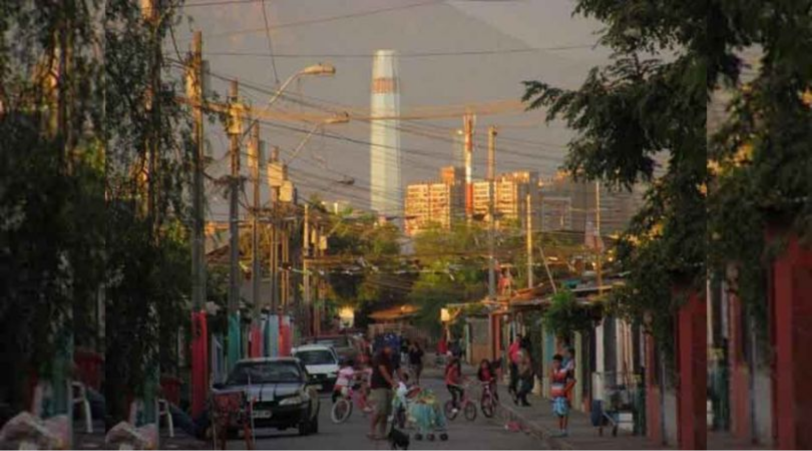
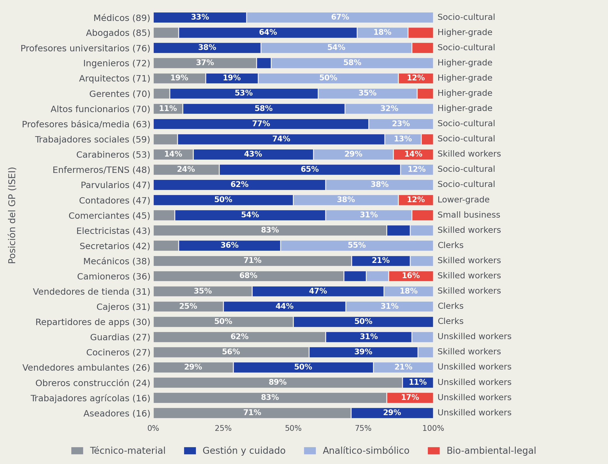
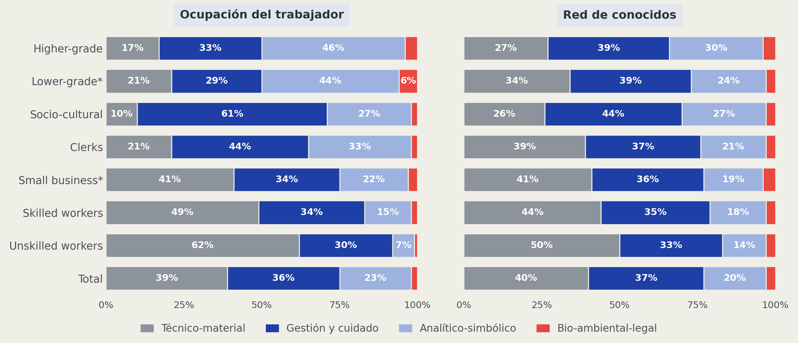
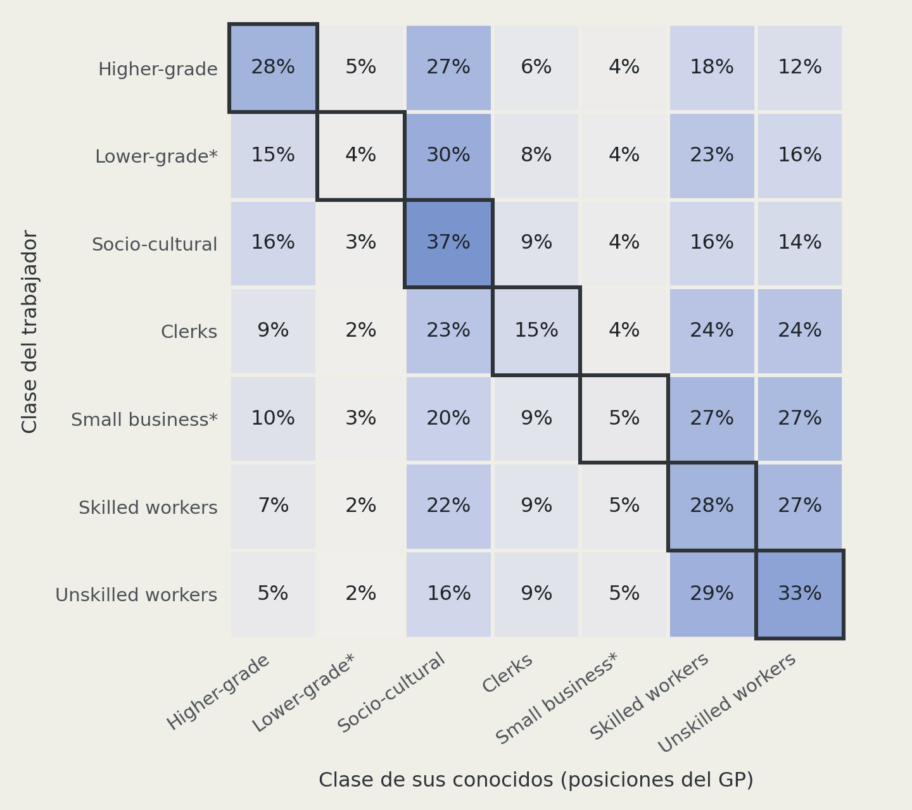
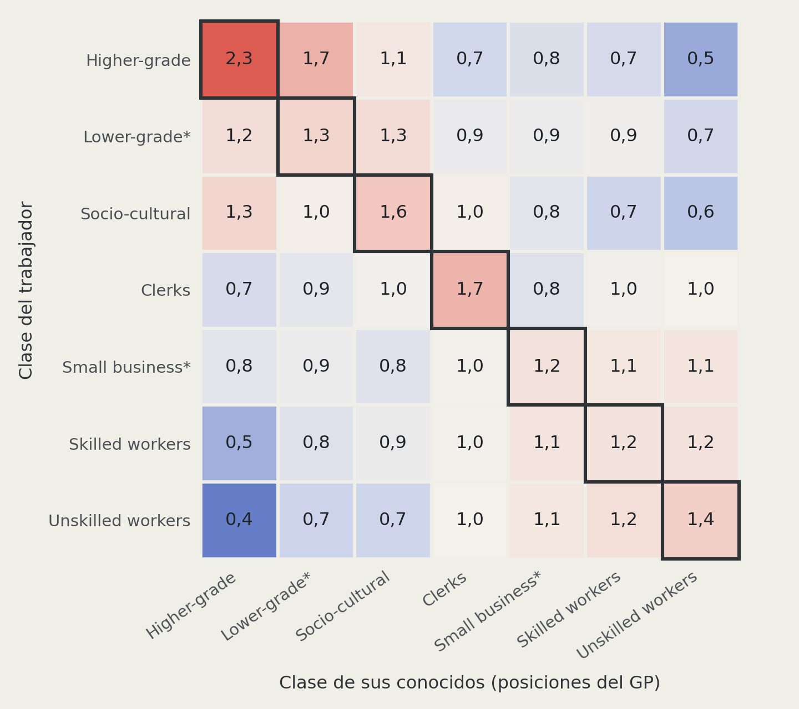
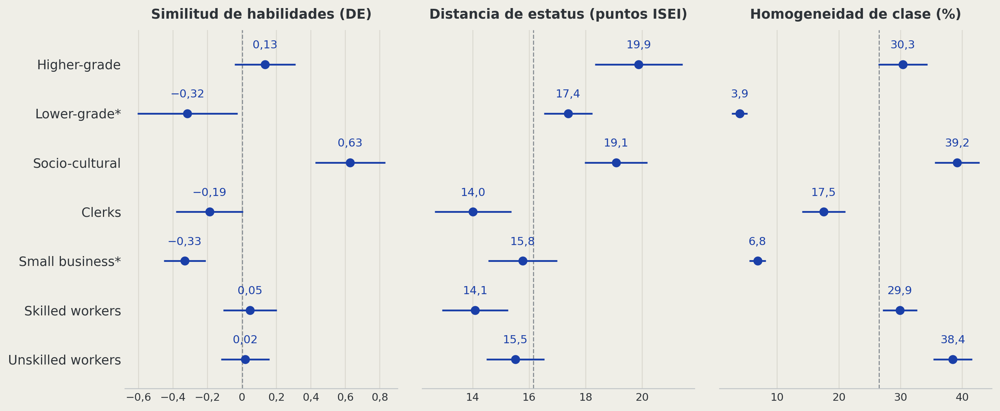
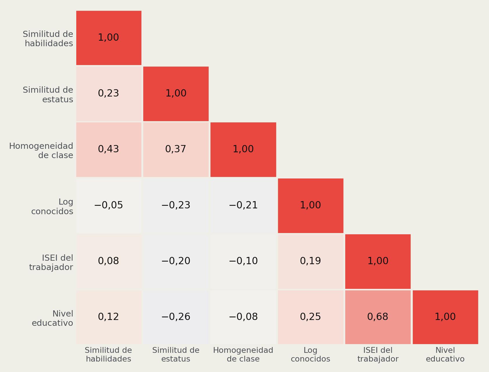
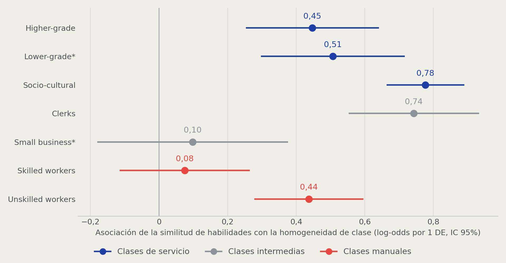

## Cierre social en redes personales: clase, estatus y habilidades en la Región Metropolitana {.title-redes}

::: {.title-rule}
:::

::: {.autor}
Trajan Pirkovic Palma¹ ²
:::

::: {.afiliacion}
¹ Instituto de Sociología, Pontificia Universidad Católica de Chile

² Fondecyt: Class, personal networks and political attitudes
:::

::: {.equipo}
Profesora Guía: Andrea Canales Hernández

Profesor Co-Tutor: Gabriel Otero Cabrol
:::

::: {.pie-portada}
Presentación de avances de tesis · 7 de octubre de 2026
:::

::: notes
Presentación de avances ante la comisión, unos 20 minutos. Del contexto a la pregunta en cinco láminas; luego objetivos, hipótesis, datos y métodos, descriptivos y un resultado.
:::

## Idea central

::: {.enunciado}
Las redes personales en Chile están segmentadas por clase: son un espacio de **cierre social** que ayuda a reproducir la desigualdad.
:::

::: {.idea .azul-bar}
Sabemos que ese cierre sigue la clase, el estatus y la educación; **no sabemos si también sigue lo que las personas saben hacer en su trabajo**
:::

::: {.idea .azul-bar}
Mido la **similitud de habilidades laborales** entre 971 trabajadores de la Región Metropolitana y sus conocidos, con el perfil ESCO de 27 ocupaciones
:::

::: {.idea .azul-bar}
Pregunto si las habilidades son **una dimensión del cierre social**: si su similitud se asocia con **redes más homogéneas en clase**, y si esa asociación **varía según la clase** del trabajador y **la similitud de estatus** de su red
:::

::: {.box-inv-4 .sp-after style="font-size: 60%;"}
Primer resultado: redes más parecidas en habilidades son más homogéneas en clase, más allá de características socioeconómicas.
:::

::: notes
Pitch de 30 a 60 segundos. Cierre social: los grupos trazan fronteras que restringen a otros el acceso a recursos y oportunidades (Weber; Parkin). Una frase por línea: problema (redes segmentadas como espacio de cierre), brecha (no sabemos si las habilidades también separan), cómo lo estudio (similitud de habilidades con ESCO y el generador de posiciones) y qué pregunto (homogeneidad de clase, y su variación según clase y similitud de estatus). Cerrar con el primer resultado.
:::

## De La Pintana a Costanera

{width="88%" fig-align="center"}

::: notes
Imagen de apertura: la misma ciudad, mundos sociales distintos. La desigualdad no solo se ve en los ingresos o en el territorio, sino en con quién se encuentra y se relaciona la gente. Pasar desde aquí al problema de investigación.
:::

# Problema de investigación {.xlarge data-background-color="#173F8A"}

## Desigualdad que se reproduce

::: {.enunciado}
La desigualdad en Chile no es solo de ingresos: también es relacional.
:::

::: {.idea}
Chile es muy desigual: Gini de 0,47 en el ingreso monetario de los hogares [(Ministerio de Desarrollo Social y Familia, 2023; Flores et al., 2020; Torche, 2014)]{.cita}
:::

::: {.idea}
Las redes personales están segmentadas por clase: hay contacto entre clases, pero con fronteras marcadas [(Otero et al., 2021, 2026; Lindh et al., 2021; PNUD, 2017)]{.cita}
:::

::: {.idea}
Las redes traspasan recursos y oportunidades: información, empleo, recomendaciones [(Lin, 2001; DiMaggio y Garip, 2012; Contreras et al., 2019)]{.cita}
:::

::: {.idea}
Si las redes están segmentadas, ayudan a reproducir la desigualdad
:::

::: {.box-inv-4 .sp-after style="font-size: 62%;"}
Objetivo de fondo: entender los mecanismos por los que la desigualdad se reproduce.
:::

::: notes
Frase para decir: la desigualdad se mide en ingresos, pero se reproduce también en con quién se relaciona la gente.
Ingresos: 0,47 es el Gini del ingreso monetario en Casen 2022, el más bajo de la serie y aun así alto; con datos tributarios Chile está entre los más desiguales de la OCDE (Flores et al.), y la desigualdad persiste entre generaciones, sobre todo arriba (Torche).
Redes: Chile es "abierto pero segregado" (Otero, Völker y Rözer): hay contacto entre clases, pero la homogeneidad de clase es alta arriba y abajo, y persiste aun con movilidad (Otero et al., 2026). El PNUD muestra que la desigualdad también se vive en el trato cotidiano.
Por qué importa: las redes canalizan información, empleo y oportunidades; el estatus de los contactos se asocia con el logro (Contreras et al.).
:::

## Fronteras: vertical y horizontal

::: {.enunciado}
La literatura mira las fronteras de las redes sobre todo en vertical.
:::

::: columns
::: {.column width="50%"}
::: {.etq}
Lo estudiado: vertical
:::

::: {.idea .azul-bar}
Clase, estatus ocupacional (ISEI) o educación
:::

::: {.idea .azul-bar}
Segregación entre quienes están arriba y abajo [(Otero et al., 2021; Espinosa-Rada et al., 2026; Alecu et al., 2022)]{.cita}
:::
:::
::: {.column width="50%"}
::: {.etq}
Lo que falta: horizontal
:::

::: {.idea}
Las habilidades son activos [(Wright, 2005)]{.cita}
:::

::: {.idea}
Hay lógicas de trabajo técnicas, organizacionales e interpersonales [(Oesch, 2006)]{.cita}
:::
:::
:::

::: {.box-inv-4 .sp-after style="font-size: 62%;"}
Hay lógicas verticales, pero también horizontales. 
¿Las fronteras de las redes se forman también por el **tipo de trabajo**?
:::

::: notes
Frase para decir: sabemos que las redes se cierran por clase y estatus; no sabemos si también se cierran por lo que las personas saben hacer.
Los estudios de redes y clase miden la segregación con clase o ISEI: las fronteras se piensan como arriba y abajo. La teoría de clases pone en el centro el contenido del trabajo (Wright, Oesch), pero esa dimensión casi no se ha llevado a las redes de conocidos.
Ejemplo: electricista (ISEI 43) y secretario (42) están a la misma altura, pero uno trabaja con cosas y el otro con información.
Espinosa-Rada et al. usan el término prestigio; en la tesis se usa estatus (ISEI).
:::

## ¿Por qué habilidades laborales?

::: {.enunciado}
Las habilidades laborales permiten ver fronteras que el estatus y la clase no distinguen.
:::

::: {.idea}
**Son un recurso, no solo un rasgo:** dan acceso a posiciones y recompensas [(Wright, 2005; Oesch, 2006)]{.cita}
:::

::: {.idea}
**Organizan los encuentros:** el trabajo reúne a quienes hacen cosas parecidas en los mismos lugares y oficios [(Feld, 1981; Weeden y Grusky, 2005)]{.cita}
:::

::: {.idea}
**Pueden ser base de acaparamiento:** saberes, credenciales y licencias restringen el acceso a ocupaciones [(Parkin, 1979; Tilly, 1998; Weeden, 2002)]{.cita}
:::

::: {.idea}
**Se pueden medir ocupación por ocupación:** forman comunidades de trabajo con estructura propia [(Alabdulkareem et al., 2018; Comisión Europea, s. f.)]{.cita}
:::

::: {.box-inv-4 .sp-after style="font-size: 58%;"}
A la misma altura, trabajos distintos: electricistas (ISEI 43) trabajan con cosas; secretarios (42), con información.
:::

::: notes
Es el centro de la propuesta. Cuatro razones: las habilidades son un activo de clase (Wright) y un criterio de clase (Oesch); el trabajo organiza los encuentros, porque reúne a gente que hace cosas parecidas (Feld; Weeden y Grusky); los saberes y credenciales pueden servir para acaparar oportunidades (Parkin; Tilly; Weeden); y hoy se pueden medir con ESCO. Mecanismos posibles por los que la similitud de habilidades organizaría las redes: información sobre oportunidades, aspiraciones y modelos de rol, selección estructural y cierre; con datos transversales se observan los dos últimos.
:::

## Propósito

::: {.enunciado}
Examinar si la similitud de habilidades laborales es una dimensión del cierre social en las redes personales, distinta del estatus socioeconómico ocupacional y de las credenciales educativas.
:::

::: {.etq}
Aportes esperados
:::

::: {.idea .azul-bar}
Incorporar una medida de habilidades (ESCO) al estudio de redes y clase
:::

::: {.idea .azul-bar}
Distinguir lo que produce la estructura ocupacional de lo que es relación
:::

::: {.idea .azul-bar}
Distinguir tipos de frontera: horizontal y vertical
:::

::: notes
Las habilidades se examinan como una dimensión del cierre social junto al estatus y la educación, las tres al mismo nivel: ninguna es la que hay que superar.
:::

## Pregunta de investigación {.frase}

¿Cómo interactúan el [nivel socioeconómico]{.azul} de los trabajadores y su [similitud de habilidades laborales y de estatus]{.azul} con la [homogeneidad de clase]{.rojo} de sus redes personales, en la Región Metropolitana en 2025?

::: notes
El nivel socioeconómico es del trabajador (clase, nivel educativo e ingreso); las similitudes se miden entre el trabajador y sus conocidos; el resultado es la homogeneidad de clase de sus redes. La clase y la similitud de estatus son las dos interacciones (H2 y H3).
:::

# Objetivos e hipótesis {.xlarge data-background-color="#173F8A"}

## Objetivos

::: {style="font-size: 60%;"}

| | Objetivo específico |
|--|--------------------|
| **OE1** | **Describir** la similitud de habilidades laborales y de estatus entre los trabajadores de la Región Metropolitana y sus conocidos en 2025 |
| **OE2** | **Estimar** la asociación entre la similitud de habilidades laborales con sus conocidos y la homogeneidad de clase de las redes de los trabajadores de la Región Metropolitana en 2025, más allá de sus características socioeconómicas |
| **OE3** | **Examinar** la variación de esa asociación según la clase de los trabajadores y su similitud de estatus con sus conocidos |

:::

::: notes
El objetivo general replica la pregunta. OE1 es descriptivo y no lleva hipótesis. OE2 estima la asociación central (H1); OE3, si cambia según la clase (H2) y según la similitud de estatus (H3). H3 permite distinguir una frontera horizontal (las habilidades separan por sí solas) de una vertical (se refuerzan cuando coincide el estatus).
:::

## Hipótesis OE2: asociación

::: {.etq}
OE2 · trabajadores de la Región Metropolitana
:::

::: {.hipotesis}
**H1.** A **mayor similitud de habilidades laborales** con sus conocidos, **mayor homogeneidad de clase** de sus redes, más allá de características socioeconómicas [(Wright, 2005; Oesch, 2006; Weeden y Grusky, 2005)]{.cita}
:::

::: {.bajada}
En simple: quienes tienen conocidos parecidos a ellos en lo que saben hacer tienen redes más concentradas en su propia clase, comparando personas de igual clase, nivel educativo, ingreso, sexo y edad.
:::

::: notes
H1 es correlacional: redes más parecidas al trabajador en habilidades, más concentradas en su propia clase. Las características socioeconómicas van como controles: clase, nivel educativo, ingreso, sexo y edad. Estado: estimada.
:::

## Hipótesis OE3: variación

::: {.etq}
OE3 · trabajadores de la Región Metropolitana
:::

::: {.hipotesis}
**H2.** La asociación entre la similitud de habilidades laborales y la homogeneidad de clase es **mayor en las clases manuales** que en las clases de servicio [(Parkin, 1979; Weeden, 2002; Weeden y Grusky, 2005)]{.cita}
:::

::: {.bajada}
En simple: donde no hay credenciales que cierren el acceso, el oficio compartido sería la base principal de la frontera de clase.
:::

::: {.hipotesis}
**H3.** La asociación entre la similitud de habilidades laborales y la homogeneidad de clase es **mayor cuanto mayor es la similitud de estatus** con sus conocidos [(Blau, 1977)]{.cita}
:::

::: {.bajada}
En simple: la frontera sería más fuerte cuando los conocidos se parecen al trabajador en lo que saben hacer y, además, en estatus; las fronteras se refuerzan cuando coinciden.
:::

::: notes
H2 y H3 son interacciones sobre la misma relación de H1. H2 mira la posición del trabajador (su clase, siete clases de Oesch, referencia Unskilled); H3 mira la composición de su red (su similitud de estatus). H3 permite leer si la frontera es horizontal o vertical. Estado: estimadas.
:::

# Datos y métodos {.xlarge data-background-color="#173F8A"}

## Datos

::: {.enunciado}
Encuesta *Class, Personal Networks and Political Attitudes* (Fondecyt), Región Metropolitana, 2025.
:::

::: {.idea .azul-bar}
**Generador de posiciones:** "¿cuántas personas que usted conoce son…?", en 27 ocupaciones [(Lin y Dumin, 1986)]{.cita}
:::

::: {.idea .azul-bar}
**971 trabajadores** y 30.207 menciones a conocidos
:::

::: {.idea .azul-bar}
Clase de Oesch en siete clases [(Oesch, 2006)]{.cita} · ponderador muestral
:::

::: notes
El generador no pregunta por nombres, sino cuántas personas conoce en cada ocupación: familiares, amigos u otras personas con quienes podría conversar en la calle. Los 971 incluyen 189 no ocupados, con la clase de su última ocupación. El diseño muestral (estratos y conglomerados) está pendiente.
:::

## Variable dependiente

::: columns
::: {.column width="20%"}
:::
::: {.column width="60%"}
::: {.ficha .dep style="font-size: 74%;"}
::: {.etq}
OE2 y OE3
:::
**Homogeneidad de clase de la red**

Proporción de conocidos que están en la propia clase del trabajador (Oesch, siete clases)

[De 0 a 1 · 971 trabajadores]{.gris}
:::
:::
::: {.column width="20%"}
:::
:::

::: {style="font-size: 62%;"}
$$\text{Homogeneidad}_i = \frac{\sum_p n_{ip}\, \mathbb{1}[\text{clase}_i = \text{clase}_p]}{\sum_p n_{ip}}$$
:::

::: {.box-inv-4 .sp-after style="font-size: 62%;"}
Pedro conoce a 10 personas y 8 son de su clase: homogeneidad de 0,8.
:::

::: notes
i es el trabajador; p, cada una de las 27 posiciones del generador; n_ip, cuántas personas conoce en esa posición. La homogeneidad se modela con logit fraccional porque es una proporción.
:::

## Variables independientes

::: columns
::: {.column width="50%"}
::: {.ficha style="font-size: 62%;"}
::: {.etq}
Central
:::
[**Similitud de habilidades laborales de la red**]{.azul}

Cuán cerca están, en la red de habilidades ESCO, las ocupaciones de los conocidos de la del trabajador. Promedio ponderado por número de conocidos, en DE
:::

::: {.ficha style="font-size: 62%;"}
::: {.etq}
Moderadora en H2 · control
:::
**Clase del trabajador**

Esquema de Oesch, siete clases
:::
:::
::: {.column width="50%"}
::: {.ficha style="font-size: 62%;"}
::: {.etq}
Moderadora en H3
:::
[**Similitud de estatus de la red**]{.rojo}

Cuán cerca están en la escala ISEI-08 [(Ganzeboom et al., 1992)]{.cita}: promedio ponderado de $-\lvert ISEI_i - ISEI_p \rvert$, en DE
:::

::: {.ficha style="font-size: 62%;"}
::: {.etq}
Controles
:::
Nivel educativo, ingreso, sexo y edad
:::
:::
:::

::: {.box-inv-4 .sp-after style="font-size: 60%;"}
Las medidas de red son promedios ponderados por número de conocidos: la unidad es el trabajador.
:::

::: notes
La similitud de habilidades es la variable central de toda la tesis; la clase del trabajador y la similitud de estatus de su red son las dos moderadoras; nivel educativo, ingreso, sexo y edad son controles. Las medidas de red salen de la misma fila de conocidos: solo cambia qué atributo de la posición se promedia.
:::

## De ocupaciones a habilidades

::: columns
::: {.column width="25%"}
::: {.ficha style="font-size: 54%;"}
**1 · Ocupación**

Código ISCO-08 [(OIT, 2012)]{.cita}
:::
:::
::: {.column width="25%"}
::: {.ficha style="font-size: 54%;"}
**2 · Perfil**

Habilidades esenciales en ESCO [(Comisión Europea, s. f.)]{.cita}
:::
:::
::: {.column width="25%"}
::: {.ficha style="font-size: 54%;"}
**3 · Red**

112 categorías unidas si aparecen juntas [(Alabdulkareem et al., 2018)]{.cita}
:::
:::
::: {.column width="25%"}
::: {.ficha style="font-size: 54%;"}
**4 · Comunidades**

Cuatro, con Leiden [(Traag et al., 2019)]{.cita}
:::
:::
:::

::: {style="font-size: 62%;"}

| Comunidad | Trabajo con | Ejemplo |
|------|-------|-------------|
| [**Técnico-material**]{.c-tec} | Cosas y entorno físico | Electricistas, 83% |
| [**Gestión y cuidado**]{.c-ges} | Personas: coordinar y atender | Profesores de básica y media, 77% |
| [**Analítico-simbólico**]{.c-ana} | Símbolos e información | Ingenieros, 58% |
| [**Bio-ambiental-legal**]{.c-bio} | Seres vivos, ambiente y derecho | Aparece de ISEI 16 a 85 |

:::

::: notes
Las comunidades no se definieron a mano: salen de cómo las habilidades aparecen juntas en las ocupaciones (coeficiente φ; modularidad 0,388). Por eso la bio-ambiental-legal reúne derecho, agricultura y ambiente. Cada ocupación es una mezcla de las cuatro; los porcentajes son la porción de las categorías de habilidades de su perfil.
:::

## Tres medidas, cuatro personas

::: {style="font-size: 54%;"}

| Persona | Conoce a | [Similitud de habilidades]{.azul} | [Similitud de estatus]{.rojo} | Homogeneidad de clase |
|-----------|---------|-----|-----|-----|
| **Pedro**, electricista (Skilled workers, ISEI 43) | Mecánicos, camioneros, cocineros | ●●● alta | ●●● alta | 100% |
| **Rosa**, obrera de construcción (Unskilled workers, ISEI 24) | Electricistas, mecánicos | ●●● alta | ●●○ media | 0% |
| **Carla**, abogada (Higher-grade, ISEI 85) | Médicos, profesores universitarios | ●○○ baja | ●●● alta | 0% |
| **Sofía**, ingeniera (Higher-grade, ISEI 72) | Gerentes, altos funcionarios | ●○○ baja | ●●● alta | 100% |

:::

::: {.box-inv-4 .sp-after style="font-size: 62%;"}
Las tres pueden ir juntas (Pedro) o separarse (Rosa, Carla, Sofía).
:::

::: notes
Niveles ilustrativos, con clases e ISEI reales del GP. Pedro: todo junto. Rosa: habilidades parecidas sin homogeneidad de clase (electricistas y mecánicos son Skilled; ella, Unskilled). Carla: estatus parecido sin habilidades ni clase. Sofía: clase y estatus sin habilidades.
:::

## Hipótesis y modelos

::: {.enunciado style="font-size: 88%;"}
Cada hipótesis tiene un modelo: una variable dependiente, una variable independiente y controles. OE1, descriptivo, usa dos regresiones cruzadas.
:::

::: {style="font-size: 46%;"}

| | Tipo de regresión | Variable dependiente | Variable independiente | Controles |
|----|----------|----------|------------|----------|
| **OE1** | Lineal | Similitud de habilidades de la red | Similitud de estatus de la red | Base |
| **OE1** | Lineal | Similitud de estatus de la red | Similitud de habilidades de la red | Base |
| **H1** | Logística fraccional | Homogeneidad de clase de la red | Similitud de habilidades de la red | Base |
| **H2** | Logística fraccional, con interacción | Homogeneidad de clase de la red | Similitud de habilidades de la red × clase | Base |
| **H3** | Logística fraccional, con interacción | Homogeneidad de clase de la red | Similitud de habilidades de la red × similitud de estatus de la red | Base |

**Base:** clase, nivel educativo, ingreso, sexo y edad. Todas ponderadas, N = 971.

:::

::: {.idea .azul-bar style="font-size: 62%;"}
**Logística fraccional:** como una logística, pero para una proporción entre 0 y 1 en vez de un sí o no
:::

::: {.idea .azul-bar style="font-size: 62%;"}
**Con interacción:** pregunta si la relación cambia según otra variable
:::

::: notes
La hipótesis dice qué signo debería tener la variable independiente: positivo en H1; en H2, una pendiente mayor en las clases manuales; en H3, una interacción positiva con la similitud de estatus. Ya no se controla el número de conocidos. Las ecuaciones están en respaldo.
:::

# Descriptivos {.xlarge data-background-color="#173F8A"}

## 27 posiciones: estatus, clase y habilidades

{width="60%" fig-align="center"}

::: {.box-inv-4 .sp-after style="font-size: 54%;"}
**Estatus parecido, contenido distinto:** electricistas (43) y secretarios (42); gerentes (70) e ingenieros (72). Bio-ambiental-legal cruza la escala sin dominar ninguna posición.
:::

::: notes
Primero, el espacio con el que se trabaja: las 27 ocupaciones del generador, ordenadas por ISEI, con su clase a la derecha y su perfil de habilidades repartido en las cuatro comunidades. Estatus y clase van juntos en buena medida; las habilidades cruzan la escala. Los porcentajes son porciones de las categorías de habilidades del perfil. Si preguntan: algunos perfiles son delgados (repartidores, 2 categorías; médicos, 3). Enfermeros o TENS usan el código 5321 porque 3221 no tiene ocupaciones en ESCO.
:::

## Trabajo y red: habilidades por clase

::: {.etq}
OE1 · similitud de habilidades
:::

{width="88%" fig-align="center"}

::: {.box-inv-4 .sp-after style="font-size: 54%;"}
La red se parece en parte al trabajo: las redes son más parecidas entre clases que las ocupaciones, pero **el gradiente se mantiene** (técnico-material en la red: 27% en Higher-grade, 50% en Unskilled).
:::

::: notes
Izquierda: cómo se reparten las habilidades de la ocupación de los trabajadores de cada clase. Derecha: lo mismo para las ocupaciones de sus conocidos. Las redes mezclan más que las ocupaciones, pero conservan el orden: quienes trabajan con cosas conocen más gente que trabaja con cosas. Bio-ambiental-legal pesa 3% a 4% en todas las redes. El espejo con controles está en respaldo: es parcial pero robusto (1,2 pp por cada 10 pp, a igual clase).
:::

## Quién conoce a quién

::: {.etq}
OE2 · homogeneidad de clase, la variable dependiente
:::

::: columns
::: {.column width="50%"}
::: {.etq}
Porcentaje de conocidos (fila = 100)
:::
{width="92%"}
:::
::: {.column width="50%"}
::: {.etq}
Observado / esperado
:::
{width="92%"}
:::
:::

::: {.box-inv-4 .sp-after style="font-size: 54%;"}
Diagonal = homogeneidad de clase. Dos bloques con poco cruce: **servicio** y **manual**. Higher-grade conoce a su clase 2,3 veces lo esperado; a Unskilled, 0,5 veces.
:::

::: notes
Izquierda: de cada 100 conocidos de un trabajador de cada clase, cuántos están en cada clase. Derecha: lo observado dividido por lo esperado si cada clase repartiera sus conocidos como el total de la muestra (no es disponibilidad poblacional Casen). Rojo, más de lo esperado; azul, menos. Skilled conoce a Unskilled tanto como a su propia clase (1,2): el oficio cruza la frontera de clase en el mundo manual, como Pedro y Rosa. Las clases con asterisco tienen una sola posición en el GP.
:::

## Tres medidas por clase

::: {.etq}
OE1 · similitud de habilidades y de estatus
:::

{width="90%" fig-align="center"}

::: {style="font-size: 44%; color: #5a6570;"}
Medias ponderadas con intervalos de 95%; línea punteada: promedio de la muestra. Similitud de habilidades: 0 = promedio. Distancia de estatus: más distancia, menos similitud. \* Una sola posición en el GP.
:::

::: {.box-inv-4 .sp-after style="font-size: 54%;"}
Socio-cultural: redes más parecidas en habilidades. Higher-grade y Socio-cultural: más lejos de sus conocidos en estatus. Homogeneidad más alta en Socio-cultural y Unskilled.
:::

::: notes
Primera respuesta a OE1. Socio-cultural conoce gente 0,63 DE más parecida en habilidades que el promedio. Higher-grade y Socio-cultural quedan a 19 o 20 puntos ISEI de sus conocidos, en parte porque el GP tiene pocas posiciones de estatus alto. Lower-grade y Small business tienen una sola posición en el GP: su homogeneidad es conocer contadores o comerciantes, y no se interpreta por clase.
:::

## Medidas distintas, no redundantes

::: {.etq}
OE1 · relación entre ambas similitudes
:::

{width="48%" fig-align="center"}

::: {.box-inv-4 .sp-after style="font-size: 54%;"}
Similitud de habilidades y de estatus: **r = 0,23**. Similitud de habilidades e ISEI del trabajador: **0,08**, no es estatus con otro nombre. Ambas se asocian con la homogeneidad de clase (0,43 y 0,37): H3 pregunta cómo se combinan.
:::

::: notes
Correlaciones ponderadas, N = 971. Esta lámina es el puente al resultado: las dos similitudes son distintas, pero ambas van con la homogeneidad de clase. H1 estima la asociación de la similitud de habilidades con la homogeneidad; H3, si esa asociación cambia según la similitud de estatus.
:::

# Resultados preliminares {.xlarge data-background-color="#173F8A"}

## Resultado OE1: dos similitudes

::: {.enunciado style="font-size: 80%;"}
**OE1.** ¿Las dos similitudes van juntas? Cada una según la otra, a igual clase, nivel educativo, ingreso, sexo y edad.
:::

::: {style="font-size: 38%;"}

| Regresión lineal | VD: similitud de habilidades de la red | VD: similitud de estatus de la red |
|--------------------|----------|----------|
| **La otra similitud de la red (1 DE)** | **0,316\*\*\*** (0,041) | **0,291\*\*\*** (0,036) |
| Higher-grade | −0,039 (0,150) | −0,226 (0,167) |
| Lower-grade\* | −0,444\*\* (0,169) | 0,221+ (0,123) |
| Socio-cultural | 0,470\*\* (0,150) | −0,145 (0,147) |
| Clerks | −0,285\* (0,119) | 0,396\*\* (0,132) |
| Small business\* | −0,415\*\*\* (0,086) | 0,177+ (0,104) |
| Skilled workers | −0,080 (0,105) | 0,277\*\* (0,093) |
| Media incompleta | −0,158 (0,170) | 0,100 (0,160) |
| Media completa | −0,259+ (0,132) | 0,014 (0,148) |
| Técnica superior | 0,120 (0,151) | −0,466\*\* (0,175) |
| **Universitaria** | 0,210 (0,159) | **−0,652\*\*\*** (0,182) |
| Log ingreso | 0,017 (0,063) | 0,127 (0,081) |
| Sin ingreso | 0,004 (0,090) | −0,327\*\*\* (0,087) |
| Mujer | −0,117+ (0,067) | −0,153\* (0,067) |
| Edad (1 DE) | 0,081\* (0,032) | −0,083\* (0,035) |
| Constante | 0,184 (0,142) | 0,287\* (0,146) |
| R² | 0,180 | 0,241 |
| N | 971 | 971 |

Ponderadas. Error estándar entre paréntesis. Ref.: Unskilled workers; básica o menos. \* Clase con una sola posición en el GP. + p < 0,1; \* p < 0,05; \*\* p < 0,01; \*\*\* p < 0,001.

:::

::: {.box-inv-4 .sp-after style="font-size: 50%;"}
Van juntas (0,3 DE por cada DE), pero no son lo mismo: la educación superior se asocia con redes **más lejanas en estatus** (−0,65), no con la similitud de habilidades.
:::

::: notes
Primera columna: cuánto se parece la red al trabajador en habilidades, según su similitud de estatus y sus características. Segunda: lo mismo para el estatus. Las dos similitudes se asocian en ambas direcciones (0,32 y 0,29 DE por cada DE), pero explican poco una de la otra (R² 0,18 y 0,24). La diferencia clave está en la educación: a igual clase, ser universitario no se asocia con la similitud de habilidades (0,21, no significativo), pero sí con redes 0,65 DE más lejanas en estatus. Socio-cultural tiene las redes más parecidas en habilidades (+0,47). Las dos clases con asterisco tienen una sola posición en el generador: no se interpretan.
:::

## Resultado H1

::: {.enunciado style="font-size: 80%;"}
**H1.** A mayor similitud de habilidades laborales con sus conocidos, mayor homogeneidad de clase de sus redes, más allá de características socioeconómicas.
:::

::: columns
::: {.column width="30%"}
::: {.ficha .dep style="font-size: 50%;"}
::: {.etq}
Variable dependiente
:::
**Homogeneidad de clase de la red**

Proporción de conocidos en la propia clase
:::
:::
::: {.column width="30%"}
::: {.ficha style="font-size: 50%;"}
::: {.etq}
Variable independiente
:::
[**Similitud de habilidades de la red**]{.azul}

En DE
:::
:::
::: {.column width="40%"}
::: {.ficha style="font-size: 50%;"}
::: {.etq}
Controles
:::
Clase, nivel educativo, ingreso, sexo y edad
:::
:::
:::

::: columns
::: {.column width="52%"}
::: {style="font-size: 40%;"}

| Regresión logística fraccional | Coeficiente (EE) |
|------------------|----------|
| **Similitud de habilidades de la red (1 DE)** | **0,402\*\*\*** (0,045) |
| Media incompleta | −0,268 (0,176) |
| Media completa | −0,332\* (0,158) |
| Técnica superior | −0,621\*\*\* (0,174) |
| Universitaria | −0,769\*\*\* (0,195) |
| Log ingreso | 0,162\* (0,072) |
| Sin ingreso | −0,321\*\* (0,103) |
| Mujer | 0,060 (0,070) |
| Edad (1 DE) | 0,003 (0,037) |

:::
:::
::: {.column width="48%"}
::: {style="font-size: 40%;"}

| Clase del trabajador | Coeficiente (EE) |
|------------------|----------|
| Higher-grade | −0,117 (0,162) |
| Lower-grade\* | −2,404\*\*\* (0,181) |
| Socio-cultural | 0,123 (0,140) |
| Clerks | −0,960\*\*\* (0,127) |
| Small business\* | −1,961\*\*\* (0,133) |
| Skilled workers | −0,341\*\*\* (0,094) |
| Constante | −0,117 (0,165) |
| Pseudo-R² | 0,476 |
| N | 971 |

:::
:::
:::

::: {style="font-size: 38%; color: #5a6570;"}
Ponderada. Coeficientes en log-odds; error estándar entre paréntesis. Ref.: básica o menos; Unskilled workers. + p < 0,1; \* p < 0,05; \*\* p < 0,01; \*\*\* p < 0,001. Clase \*: una sola posición en el GP; los coeficientes de clase no se interpretan.
:::

::: {.box-inv-4 .sp-after style="font-size: 54%;"}
Consistente con H1: más allá de características socioeconómicas, 1 DE más de similitud de habilidades se asocia con **+7,3 pp** de homogeneidad de clase.
:::

::: notes
Lectura: dos trabajadores de igual clase, educación, ingreso, sexo y edad; si la red de uno es 1 DE más parecida a él en habilidades, se espera 7,3 pp más de homogeneidad de clase. Los 7,3 pp son el cambio medio en la homogeneidad predicha al sumar 1 DE de similitud de habilidades a cada trabajador.
Si preguntan: con la especificación anterior (con número de conocidos) el coeficiente era 0,378; sin él sube a 0,402. Con la similitud de estatus en el modelo (regresión de H3), la similitud de habilidades sigue asociada (0,268). Los coeficientes de clase no se interpretan, porque dependen de cuántas posiciones tiene cada clase en el generador. Pendiente: cuánto de esta asociación produce la estructura de ocupaciones (descomposición con redes de referencia, en desarrollo).
:::

## Resultado H2: variación según clase

::: {.enunciado style="font-size: 80%;"}
**H2.** La asociación entre la similitud de habilidades laborales y la homogeneidad de clase es mayor en las clases manuales que en las clases de servicio.
:::

{width="64%" fig-align="center"}

::: {style="font-size: 38%; color: #5a6570;"}
Regresión logística fraccional ponderada con interacción similitud de habilidades de la red × clase; mismos controles que H1. Pseudo-R² 0,507; N = 971. \* Clase con una sola posición en el GP. Coeficientes en respaldo.
:::

::: {.box-inv-4 .sp-after style="font-size: 62%;"}
No se sostiene: más fuerte en Socio-cultural (0,78) y Clerks (0,74), casi nula en Skilled workers (0,08). En los oficios calificados, el oficio cruza la clase.
:::

::: notes
Cada punto es la pendiente de la similitud de habilidades dentro de una clase, con su intervalo de 95%. H2 esperaba pendientes mayores en las clases manuales (rojo) que en las de servicio (azul). El resultado va casi en sentido contrario: Unskilled (0,44) se parece a Higher-grade (0,45), Skilled workers está cerca de cero, y Socio-cultural y Clerks tienen las asociaciones más fuertes. Esto calza con los descriptivos: Skilled conoce a Unskilled tanto como a su propia clase; el oficio cruza la frontera de clase en lugar de cerrarla. Una hipótesis refutada también es un aporte. Las clases con asterisco tienen una sola posición en el generador: sus pendientes son poco estables.
:::

## Resultado H3: variación según similitud de estatus

::: {.enunciado style="font-size: 80%;"}
**H3.** La asociación entre la similitud de habilidades laborales y la homogeneidad de clase es mayor cuanto mayor es la similitud de estatus con sus conocidos.
:::

::: columns
::: {.column width="52%"}
::: {style="font-size: 40%;"}

| Regresión logística fraccional | Coeficiente (EE) |
|------------------|----------|
| Similitud de habilidades de la red (1 DE) | 0,268\*\*\* (0,045) |
| Similitud de estatus de la red (1 DE) | 0,455\*\*\* (0,049) |
| **Habilidades × estatus** | **0,049** (0,043) |
| Media incompleta | −0,250 (0,159) |
| Media completa | −0,299\* (0,140) |
| Técnica superior | −0,400\*\* (0,153) |
| Universitaria | −0,433\* (0,187) |
| Log ingreso | 0,126+ (0,067) |
| Sin ingreso | −0,217\* (0,095) |
| Mujer | 0,173\*\* (0,063) |
| Edad (1 DE) | 0,033 (0,036) |

:::
:::
::: {.column width="48%"}
::: {style="font-size: 40%;"}

| Clase del trabajador | Coeficiente (EE) |
|------------------|----------|
| Higher-grade | −0,028 (0,163) |
| Lower-grade\* | −2,449\*\*\* (0,179) |
| Socio-cultural | 0,218 (0,151) |
| Clerks | −1,131\*\*\* (0,117) |
| Small business\* | −2,044\*\*\* (0,138) |
| Skilled workers | −0,442\*\*\* (0,089) |
| Constante | −0,342\* (0,142) |
| Pseudo-R² | 0,561 |
| N | 971 |

:::
:::
:::

::: {style="font-size: 38%; color: #5a6570;"}
Ponderada. Coeficientes en log-odds; error estándar entre paréntesis. Ref.: básica o menos; Unskilled workers. + p < 0,1; \* p < 0,05; \*\* p < 0,01; \*\*\* p < 0,001. Clase \*: una sola posición en el GP.
:::

::: {.box-inv-4 .sp-after style="font-size: 52%;"}
No se sostiene: la interacción es pequeña y no significativa (0,049; p = 0,25). La asociación de las habilidades no depende de que coincida el estatus: lectura **horizontal**.
:::

::: notes
La fila clave es la interacción habilidades × estatus: si H3 fuera cierta, sería positiva y clara. Es 0,049 con error 0,043, no distinguible de cero. Ambas similitudes se asocian con la homogeneidad de clase por separado (0,27 y 0,46), pero no se potencian. Lectura: la frontera de habilidades opera igual coincida o no el estatus, lo que favorece la lectura horizontal. Cautela: no encontrar interacción no prueba que no exista.
:::

## Síntesis y próximos pasos

::: columns
::: {.column width="50%"}
::: {.etq}
Hasta ahora
:::

::: {.idea .azul-bar}
Habilidades y estatus de la red: van juntas, pero son distintas (OE1)
:::

::: {.idea .azul-bar}
Redes más parecidas en habilidades, más homogéneas en clase: +7,3 pp (H1)
:::

::: {.idea .azul-bar}
No es mayor en las clases manuales: casi nula en Skilled, fuerte en Socio-cultural (H2)
:::

::: {.idea .azul-bar}
No depende de la similitud de estatus: frontera horizontal (H3)
:::
:::
::: {.column width="50%"}
::: {.etq}
Próximos pasos
:::

::: {.idea}
Descomposición: cuánto es estructura y cuánto relación
:::

::: {.idea}
Discutir H2: el oficio que cruza la clase
:::

::: {.idea}
Diseño muestral completo y escritura
:::
:::
:::

::: {.box-inv-4 .sp-after style="font-size: 58%;"}
Las habilidades se asocian con redes más cerradas en su clase, de forma horizontal y desigual entre clases.
:::

::: notes
Resultados preliminares. H1 se sostiene; H2 y H3 no, y ambas refutaciones dicen algo: en los oficios calificados las habilidades cruzan la clase, y la frontera de habilidades no necesita coincidir con el estatus para operar.
:::

## Referencias

::: {style="font-size: 38%; column-count: 2; column-gap: 2em; text-align: left;"}

Alabdulkareem, A., Frank, M. R., Sun, L., AlShebli, B., Hidalgo, C., & Rahwan, I. (2018). Unpacking the polarization of workplace skills. *Science Advances, 4*(7), eaao6030. https://doi.org/10.1126/sciadv.aao6030

Alecu, A. I., Helland, H., Hjellbrekke, J., & Jarness, V. (2022). Who you know: The classed structure of social capital. *The British Journal of Sociology, 73*(3), 505–535. https://doi.org/10.1111/1468-4446.12945

Blau, P. M. (1977). *Inequality and heterogeneity: A primitive theory of social structure*. Free Press.

Comisión Europea. (s. f.). *ESCO: European Skills, Competences, Qualifications and Occupations*. https://esco.ec.europa.eu

Contreras, D., Otero, G., Díaz, J. D., & Suárez, N. (2019). Inequality in social capital in Chile: Assessing the importance of network size and contacts' occupational prestige on status attainment. *Social Networks, 58*, 59–77. https://doi.org/10.1016/j.socnet.2019.02.002

DiMaggio, P., & Garip, F. (2012). Network effects and social inequality. *Annual Review of Sociology, 38*, 93–118. https://doi.org/10.1146/annurev.soc.012809.102545

Espinosa-Rada, A., Bargsted, M., & Ortiz Ruiz, F. (2026). Socioeconomic homogeneity in acquaintance networks: Occupational prestige, education, and intergenerational mobility. *Social Networks, 86*, 342–353.

Feld, S. L. (1981). The focused organization of social ties. *American Journal of Sociology, 86*(5), 1015–1035.

Flores, I., Sanhueza, C., Atria, J., & Mayer, R. (2020). Top incomes in Chile: A historical perspective on income inequality, 1964–2017. *Review of Income and Wealth, 66*(4), 850–874. https://doi.org/10.1111/roiw.12441

Ganzeboom, H. B. G. (2010). *A new International Socio-Economic Index (ISEI) of occupational status for the International Standard Classification of Occupation 2008 (ISCO-08) constructed with data from the ISSP 2002–2007* [Ponencia]. Annual Conference of the International Social Survey Programme, Lisboa.

Ganzeboom, H. B. G., De Graaf, P. M., & Treiman, D. J. (1992). A standard international socio-economic index of occupational status. *Social Science Research, 21*(1), 1–56.

Lin, N. (2001). *Social capital: A theory of social structure and action*. Cambridge University Press.

Lin, N., & Dumin, M. (1986). Access to occupations through social ties. *Social Networks, 8*(4), 365–385.

:::

## Referencias

::: {style="font-size: 38%; column-count: 2; column-gap: 2em; text-align: left;"}

Lindh, A., Andersson, A. B., & Volker, B. (2021). The missing link: Network influences on class divides in political attitudes. *European Sociological Review, 37*(5), 695–712. https://doi.org/10.1093/esr/jcab010

Ministerio de Desarrollo Social y Familia. (2023). *Encuesta de Caracterización Socioeconómica Nacional (Casen) 2022: Ingresos de los hogares. Síntesis de resultados*. Observatorio Social.

Oesch, D. (2006). *Redrawing the class map: Stratification and institutions in Britain, Germany, Sweden and Switzerland*. Palgrave Macmillan.

Organización Internacional del Trabajo. (2012). *Clasificación Internacional Uniforme de Ocupaciones: CIUO-08*. OIT.

Otero, G., Plaza, A., & Zavala-Aránguiz, I. (2026). Social mobility and class segregation in personal networks over time: Evidence from longitudinal data. *Frontiers in Sociology, 11*. https://doi.org/10.3389/fsoc.2026.1782127

Otero, G., Völker, B., & Rözer, J. (2021). Open but segregated? Class divisions and the network structure of social capital in Chile. *Social Forces, 100*(2), 649–679.

Parkin, F. (1979). *Marxism and class theory: A bourgeois critique*. Tavistock.

Programa de las Naciones Unidas para el Desarrollo [PNUD]. (2017). *Desiguales. Orígenes, cambios y desafíos de la brecha social en Chile*. PNUD.

Tilly, C. (1998). *Durable inequality*. University of California Press.

Torche, F. (2014). Intergenerational mobility and inequality: The Latin American case. *Annual Review of Sociology, 40*, 619–642. https://doi.org/10.1146/annurev-soc-071811-145521

Traag, V. A., Waltman, L., & van Eck, N. J. (2019). From Louvain to Leiden: Guaranteeing well-connected communities. *Scientific Reports, 9*, 5233.

Weeden, K. A. (2002). Why do some occupations pay more than others? Social closure and earnings inequality in the United States. *American Journal of Sociology, 108*(1), 55–101. https://doi.org/10.1086/344121

Weeden, K. A., & Grusky, D. B. (2005). The case for a new class map. *American Journal of Sociology, 111*(1), 141–212. https://doi.org/10.1086/428815

Wright, E. O. (2005). Foundations of a neo-Marxist class analysis. En E. O. Wright (Ed.), *Approaches to class analysis* (pp. 4–30). Cambridge University Press.

:::

## Cierre social en redes personales: clase, estatus y habilidades en la Región Metropolitana {#portada-cierre .title-redes}

::: {.title-rule}
:::

::: {.autor}
Trajan Pirkovic Palma¹ ²
:::

::: {.afiliacion}
¹ Instituto de Sociología, Pontificia Universidad Católica de Chile

² Fondecyt: Class, personal networks and political attitudes
:::

::: {.equipo}
Profesora Guía: Andrea Canales Hernández

Profesor Co-Tutor: Gabriel Otero Cabrol
:::

::: {.pie-portada}
Presentación de avances de tesis · 7 de octubre de 2026
:::

# Respaldo {.xlarge data-background-color="#173F8A"}

## Espejo de habilidades (especificación anterior)

::: {.enunciado style="font-size: 80%;"}
**OE1 · similitud de habilidades.** ¿La composición de habilidades de la red refleja la del trabajo?
:::

::: columns
::: {.column width="30%"}
::: {.ficha .dep style="font-size: 50%;"}
::: {.etq}
Variable dependiente
:::
**Composición de la red**

Porción de cada comunidad de habilidades en las ocupaciones de sus conocidos (pp)
:::
:::
::: {.column width="30%"}
::: {.ficha style="font-size: 50%;"}
::: {.etq}
Variable independiente
:::
[**Composición del trabajo**]{.azul}

Porción de cada comunidad en la ocupación del trabajador (pp)
:::
:::
::: {.column width="40%"}
::: {.ficha style="font-size: 50%;"}
::: {.etq}
Controles
:::
Sexo, edad, nivel educativo, ingreso y número de conocidos; luego clase. Cada uno por comunidad
:::
:::
:::

::: columns
::: {.column width="58%"}
::: {style="font-size: 44%;"}

| Regresión lineal, por pasos | Coeficiente espejo (EE) |
|------------------|----------|
| 1 · Sin controles | 2,61\*\*\* (0,14) |
| 2 · + sexo, edad, nivel educativo, ingreso y conocidos | 1,32\*\*\* (0,16) |
| 3 · + clase | **1,24\*\*\*** (0,17) |
| **Paso 2, por comunidad:** | |
| [Técnico-material]{.c-tec} | 1,70\*\*\* (0,23) |
| [Gestión y cuidado]{.c-ges} | 1,23\*\*\* (0,17) |
| [Analítico-simbólico]{.c-ana} | 0,80\*\*\* (0,19) |
| [Bio-ambiental-legal]{.c-bio} | 0,65\*\*\* (0,16) |
| N | 3.884 filas (971 trabajadores × 4 comunidades) |

Ponderada. Pp de la comunidad en la red por cada 10 pp en el trabajo: 0 = la red no refleja el trabajo; 10 = espejo perfecto. Error estándar entre paréntesis, agrupado por trabajador. \*\*\* p < 0,001.

:::
:::
::: {.column width="42%"}
::: {.ficha style="font-size: 58%; text-align: center;"}
[1,2 pp]{.cifra}
más de una comunidad en la red por cada 10 pp más en el trabajo, a igual clase
:::
:::
:::

::: {.box-inv-4 .sp-after style="font-size: 54%;"}
La red refleja en parte el trabajo: la mitad del espejo va junto con nivel educativo e ingreso (2,61 → 1,32) y casi no cambia con la clase (1,32 → 1,24).
:::

::: notes
Cada trabajador tiene dos "tortas" con las mismas cuatro porciones: su trabajo y su red. El coeficiente espejo dice cuánto sube una porción en la red cuando sube 10 pp en el trabajo. Es parcial pero robusto, y más fuerte en técnico-material (1,70) que en analítico-simbólico (0,80) y bio-ambiental-legal (0,65). Se estima en formato largo (una fila por trabajador y comunidad) porque las cuatro porciones suman 100; los controles entran por comunidad, por eso la tabla muestra solo el coeficiente espejo. El R² (0,79) viene sobre todo de que cada comunidad pesa distinto en todas las redes; no mide el espejo. En los scripts es el Modelo A.
:::

## Ecuaciones: H1, H2 y H3

::: {style="font-size: 58%;"}

**H1 · logística fraccional**

$$\operatorname{logit} E(\text{Hom}_i) = \beta_0 + \beta_1\, SH_i + \textstyle\sum_c \kappa_c\, \text{Clase}_{ic} + \gamma' X_i \qquad \text{H1: } \beta_1 > 0$$

**H2 · con interacción por clase**

$$\text{H1} + \textstyle\sum_c \delta_c \,(SH_i \times \text{Clase}_{ic}) \qquad \text{H2: pendiente de } SH \text{ mayor en clases manuales}$$

**H3 · con interacción por similitud de estatus**

$$\text{H1} + \beta_2\, SP_i + \beta_3 \,(SH_i \times SP_i) \qquad \text{H3: } \beta_3 > 0$$

:::

::: {.box-inv-4 .sp-after style="font-size: 54%;"}
$\text{Hom}_i$: homogeneidad de clase · $SH_i$: similitud de habilidades de la red · $SP_i$: similitud de estatus de la red · $X_i$: nivel educativo, ingreso, sexo y edad. Ponderadas, N = 971. Referencia de clase: Unskilled workers.
:::

## Regresión de H2: coeficientes

::: columns
::: {.column width="52%"}
::: {style="font-size: 40%;"}

| Regresión logística fraccional | Coeficiente (EE) |
|------------------|----------|
| **Similitud de habilidades (1 DE), Unskilled** | **0,437\*\*\*** (0,081) |
| × Higher-grade | 0,010 (0,126) |
| × Lower-grade\* | 0,070 (0,136) |
| × Socio-cultural | 0,340\*\*\* (0,099) |
| × Clerks | 0,307\* (0,127) |
| × Small business\* | −0,338\* (0,160) |
| × Skilled workers | −0,362\*\* (0,128) |
| Media incompleta | −0,237 (0,184) |
| Media completa | −0,340\* (0,163) |
| Técnica superior | −0,606\*\*\* (0,182) |
| Universitaria | −0,812\*\*\* (0,199) |
| Log ingreso | 0,166\* (0,072) |
| Sin ingreso | −0,284\*\* (0,104) |
| Mujer | 0,022 (0,069) |
| Edad (1 DE) | −0,001 (0,035) |

:::
:::
::: {.column width="48%"}
::: {style="font-size: 40%;"}

| Clase del trabajador | Coeficiente (EE) |
|------------------|----------|
| Higher-grade | −0,089 (0,160) |
| Lower-grade\* | −2,405\*\*\* (0,181) |
| Socio-cultural | −0,090 (0,132) |
| Clerks | −0,976\*\*\* (0,126) |
| Small business\* | −2,020\*\*\* (0,143) |
| Skilled workers | −0,292\*\* (0,090) |
| Constante | −0,114 (0,174) |
| Pseudo-R² | 0,507 |
| N | 971 |

:::
:::
:::

::: {style="font-size: 38%; color: #5a6570;"}
Ponderada. Log-odds; error estándar entre paréntesis. Las filas "×" son la diferencia de pendiente respecto de Unskilled workers. + p < 0,1; \* p < 0,05; \*\* p < 0,01; \*\*\* p < 0,001.
:::

## Tres medidas de red

::: {style="font-size: 60%;"}
$$SH_i = \frac{\sum_p n_{ip}\, SH_{ip}}{\sum_p n_{ip}} \qquad SP_i = \frac{\sum_p n_{ip}\, SP_{ip}}{\sum_p n_{ip}} \qquad \text{Homogeneidad}_i = \frac{\sum_p n_{ip}\, \mathbb{1}[\text{clase}_i = \text{clase}_p]}{\sum_p n_{ip}}$$
:::

::: {style="font-size: 54%;"}

| Medida | Construcción | Lectura |
|------|---------------|---------|
| [**Similitud de habilidades**]{.azul} | Promedio de $SH_{ip}$, ponderado por conocidos $n_{ip}$. $SH_{ip}$ es la distancia entre la ocupación del trabajador y la de la posición en la red de categorías de habilidades (pesos 1 − φ), con signo negativo | Más alto: los conocidos se parecen más al trabajador en lo que sabe hacer |
| [**Similitud de estatus**]{.rojo} | Promedio de $-\lvert ISEI_i - ISEI_p \rvert$, ponderado por conocidos. ISEI-08: estatus socioeconómico ocupacional (Ganzeboom et al., 1992; Ganzeboom, 2010) | Más alto: conocidos más cerca en la escala de estatus |
| **Homogeneidad de clase** | Proporción de conocidos en la propia clase Oesch7 | 0 a 1; dependiente de H1 y H2 |

:::

::: {.box-inv-4 .sp-after style="font-size: 54%;"}
Las tres son **promedios ponderados por número de conocidos**. Dos gasfíteres tienen la misma similitud con la posición "abogado"; los distingue a cuántos abogados conoce cada uno. Por eso la unidad es el trabajador y no la díada.
:::

::: notes
i es el trabajador; p, cada una de las 27 posiciones; n_ip, cuántas personas conoce en esa posición. Las tres medidas salen de la misma fila de conocidos: solo cambia qué atributo de la posición se promedia.
:::

## Especificación anterior: coeficientes (C1 y C2, con número de conocidos)

::: columns
::: {.column width="55%"}
::: {style="font-size: 40%;"}

| Término | C1 | C2 |
|---|---|---|
| **Similitud de habilidades (1 DE)** | **0,378 (0,044)\*\*\*** | **0,279 (0,042)\*\*\*** |
| **Similitud de estatus (1 DE)** | | **0,433 (0,047)\*\*\*** |
| Mujer | 0,058 (0,069) | 0,159 (0,062)\* |
| Edad (z) | 0,003 (0,037) | 0,032 (0,036) |
| Media incompleta | −0,232 (0,173) | −0,242 (0,156) |
| Media completa | −0,297 (0,152)+ | −0,284 (0,136)\* |
| Técnica superior | −0,561 (0,167)\*\*\* | −0,387 (0,150)\* |
| Universitaria | −0,683 (0,196)\*\*\* | −0,403 (0,184)\* |
| Log ingreso | 0,172 (0,073)\* | 0,127 (0,068)+ |
| Sin ingreso | −0,349 (0,102)\*\*\* | −0,222 (0,094)\* |
| Log conocidos (z) | −0,156 (0,044)\*\*\* | −0,080 (0,040)\* |
| Higher-grade | −0,104 (0,166) | −0,039 (0,166) |
| Lower-grade\* | −2,363 (0,180)\*\*\* | −2,435 (0,179)\*\*\* |
| Socio-cultural | 0,195 (0,147) | 0,223 (0,156) |
| Clerks | −0,964 (0,124)\*\*\* | −1,128 (0,118)\*\*\* |
| Small business\* | −1,914 (0,129)\*\*\* | −2,027 (0,135)\*\*\* |
| Skilled workers | −0,341 (0,094)\*\*\* | −0,450 (0,088)\*\*\* |
| Constante | −0,171 (0,157) | −0,340 (0,133)\* |
| Pseudo-R² (devianza explicada) | 0,489 | 0,563 |

:::
:::
::: {.column width="45%"}
::: {.ficha style="font-size: 50%;"}
**Dependiente** Homogeneidad de clase: proporción de conocidos en la clase Oesch7 del trabajador

**Estimación** `svyglm` quasibinomial (logit fraccional), ponderador muestral, N = 971

**Referencias** Básica o menos; Unskilled workers

**Lectura** Logit por 1 DE; en pp, cambio medio en la probabilidad predicha
:::

::: {style="font-size: 44%;"}
Error estándar entre paréntesis. + p < 0,1; \* p < 0,05; \*\* p < 0,01; \*\*\* p < 0,001. Los coeficientes de clase no se interpretan: dependen de cuántas posiciones tiene cada clase en el GP.
:::
:::
:::

## Robustez de H1 (especificación anterior)

::: {style="font-size: 52%;"}

| Especificación | Habilidades, C1 | Habilidades, C2 | Estatus, C2 |
|---|---|---|---|
| Principal (N = 971) | 0,378 (0,044)\*\*\* | 0,279 (0,042)\*\*\* | 0,433 (0,047)\*\*\* |
| Con 3 o más conocidos (N = 962) | 0,378 (0,043)\*\*\* | 0,282 (0,040)\*\*\* | 0,419 (0,046)\*\*\* |
| Sin clase imputada (N = 782) | 0,362 (0,048)\*\*\* | 0,288 (0,045)\*\*\* | 0,391 (0,050)\*\*\* |
| Homogeneidad descontada por disponibilidad (lineal) | 0,071 (0,008)\*\*\* | 0,051 (0,007)\*\*\* | 0,071 (0,007)\*\*\* |
| Díada multinivel (9.810 díadas) | 1,047 (0,021)\*\*\* | 0,832 (0,022)\*\*\* | 1,280 (0,029)\*\*\* |

Logit por 1 DE, salvo la versión descontada (lineal). Descontada: homogeneidad menos la disponibilidad de la clase en Casen 2024 RM. Díada: misma clase (1/0), peso = conocidos, intercepto aleatorio por trabajador (ICC 0,15), `glmmTMB`.

:::

::: {.box-inv-4 .sp-after style="font-size: 56%;"}
Mismo patrón en todas: la asociación de habilidades se mantiene al agregar estatus y se atenúa entre 20% y 28%.
:::

## Muestra analítica

::: columns
::: {.column width="50%"}
::: {style="font-size: 54%;"}

| Paso | N |
|:---|---:|
| Personas en la base | 1.028 |
| Con las 27 posiciones del GP respondidas | 1.028 |
| Con al menos un conocido en el GP | 1.024 |
| ... y con clase Oesch7 (actual o imputada) | 976 |
| ... y con controles completos | 971 |

:::
:::
::: {.column width="50%"}
::: {style="font-size: 56%;"}
Los modelos de homogeneidad de clase usan 971 trabajadores; 189 no ocupados entran con la clase de su última ocupación.
:::
:::
:::
